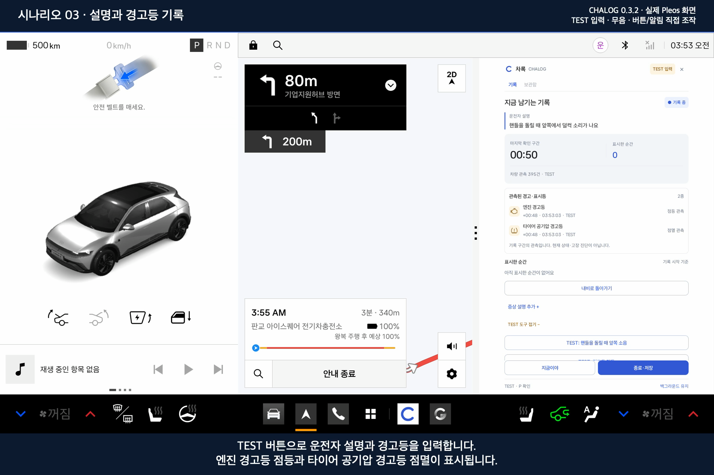

# 차록 · CHALOG

## 1. 앱 이름 및 한 줄 소개

**차록(CHALOG)** — 차량에서 느낀 이상 징후와 관측 정보를 백그라운드에서 기록하고, 주차 후 정비 상담용 메모로 확인하는 차량용 앱입니다.

영문명 CHALOG는 ‘차 + log(기록)’를 조합한 이름입니다. 한글 서비스명과 호출어는 ‘차록’을 사용합니다. 현재 버전은 **0.3.2 / versionCode 8**입니다.

## 2. 실행 방법

저장소의 [이명훈_차록_release.apk](apk/이명훈_차록_release.apk)를 내려받아 Pleos Connect 에뮬레이터에 설치합니다. 아래는 실제 검증한 `emulator-5560`, Android 사용자 `10` 기준이며, 다른 환경에서는 연결된 기기와 사용자에 맞춥니다. 저장소 루트에서 실행합니다.

```sh
adb devices -l
python3 scripts/adb_readiness.py \
  --adb "$(command -v adb)" \
  --serial emulator-5560 \
  --output /tmp/chalog-readiness.json &&
adb -s emulator-5560 install --no-incremental -r 'apk/이명훈_차록_release.apk' &&
adb -s emulator-5560 shell am start --user 10 -W \
  -a OPEN_CHALOG_RECORDS -p dev.leemh.charok
```

준비 검사는 ADB 연결, Android 부팅 완료, package/activity 서비스를 확인합니다. 앱 아이콘을 눌러 실행할 수도 있습니다. `-r`은 기존 설치를 업데이트하며, 기존 앱을 제거하거나 데이터를 초기화하지 않습니다. 서명이 다른 기존 설치에는 강제로 덮어쓰지 않습니다. 설치 ID `dev.leemh.charok`과 DB `charok.db`는 기존 기록 호환을 위해 유지합니다.

수동 TEST 흐름은 다음과 같습니다.

1. **입력 설정 → TEST 선택**으로 전환하고 `TEST · P 확인` 상태를 확인합니다.
2. **차량 상태 기록 동의 → 기록 준비 켜기 → 기록 시작**을 선택합니다. 이전 기록이 열려 있다면 ‘새 기록 준비’로 준비 화면에 돌아갑니다.
3. **TEST 도구**에서 설명·경고등을 입력하거나 **지금이야**로 순간을 표시합니다.
4. 앱 화면을 닫아도 알림에서 **지금이야 / 종료·저장**을 사용할 수 있습니다.
5. 명시적으로 앱을 열어 저장 기록과 **상담 카드**를 확인합니다. 새 프로세스로 재실행해도 기록은 남고 수집은 자동 재개되지 않습니다.

## 3. 테스트 환경 및 필요한 설정

| 항목 | 검증 환경·설정 |
| --- | --- |
| 실행 장비 | Mac M1, 메모리8GB, 외장SSD에 SDK·AVD·프로젝트 배치 |
| Android | Android14(API34), ARM64(`arm64-v8a`) |
| AVD | 기존 `CharokPleosMac` **1대** 사용, serial `emulator-5560`, 사용자10 |
| 설치 도구 | Android SDK Platform-Tools의 ADB, 준비 검사에 Python3 사용 |
| 앱 설정 | 수동 TEST 입력, 정차(P) 확인, 차량 상태 기록 동의, 차록 알림 허용 |
| 소스 빌드 도구 | JDK17, Android SDK35, 저장소의 Gradle Wrapper |

첫 실행의 기본 입력은 실제 Pleos이며 차량 상태를 확인하지 못하면 상세 보기·내보내기가 잠깁니다. 위 시연을 재현하려면 명시적으로 TEST를 선택합니다. TEST에는 실제 마이크 입력이 필요하지 않습니다. 실제 권한 요청은 Android 화면에서 처리합니다.

**검증 범위:** TEST 기록·백그라운드 알림 동작·경고등 이력·저장·새 PID 복원은 확인했습니다. 실제 Gleo 발화·등록, 실제 차량 SDK·마이크, 음악 재생, 자동 우측 창 배치, 차록의 내비 목적지 전달은 별도 검증 범위입니다. 짧은 자동 토스트는 미확인이고, 영상은 직접 펼친 알림센터를 보여 줍니다. 순정 내비의340m 경로 안내는 동작하지만 바탕지도는 비어 있습니다. 문서 선택기 stub을 실제 파일 내보내기 성공으로 표시하지 않습니다.

## 4. Pleos Connect 에뮬레이터 버전과 화면 규격

| 항목 | 개발·실행 검증에 사용한 값 |
| --- | --- |
| **Pleos Connect 에뮬레이터 버전** | **2.1.0** |
| 시스템 이미지 | Android14(API34) Automotive, ARM64 |
| **화면 해상도** | **2560 × 1440 pixels, 가로 화면** |
| 화면 밀도 | 160dpi (`density160`) |
| 화면 구성 | 왼쪽 차량정보 / 중앙 순정 내비 / 오른쪽 차록 패널 — OS에서 수동 배치 |

차록은 앱에 할당된 패널만 그립니다. 차량정보와 순정 내비는 Pleos 시스템 화면입니다. 위 값은 실제 에뮬레이터 규격이며, 자막 시연 파일의1920×1280 영상 규격과 구분합니다. [실행·시나리오 증거](docs/evidence/chalog-submission-demo-2026-11-15/README.md) · [Mac 실행 인계](docs/12-mac-pleos-handoff.md).

## 5. APK 파일 위치

**저장소 루트 기준: [`apk/이명훈_차록_release.apk`](apk/이명훈_차록_release.apk)**

개인 참가자명 ‘이명훈’, 앱 이름 ‘차록’을 사용해 공식 `팀명_앱이름_release.apk` 규격에 맞췄습니다. APK는 저장소에 직접 업로드했으므로 GitHub Releases 링크 대신 위 파일 경로를 제출합니다.

| 항목 | 제출 APK |
| --- | --- |
| 빌드·버전 | **release**,0.3.2/8,`debuggable=false` |
| 서명 | 기존 Mac 개발 인증서로 서명한 실행 가능한 심사용 APK |
| 파일 크기 | 39,725,544bytes(약37.9MiB) |
| SHA-256 | `b47b663a3a7fc52988691ab8acff59f18bda208ea668676afd63cb1463a51d3a` |
| 실행 검사 | Pleos 설치 → TEST 설명·순간 표시 → 저장 → 새 PID 재실행 성공 |

CI/Gradle의 기본 release 산출물은 미서명입니다. 위 제출 파일은 해당 release 빌드에 **별도로 개발 서명**한 APK이며, 스토어 출시용 인증서로 서명한 배포본은 아닙니다. 파일명 변경 전후 APK 내용·해시·서명은 같습니다. [APK 상세 안내](apk/README.md) · [해시·서명·실행 metadata](apk/apk-metadata.json).

## 시연 영상과 제출 자료

- [최신 CHALOG 0.3.2 한글 자막 영상 · 2분39초](docs/evidence/chalog-submission-demo-2026-11-15/chalog-verified-scenarios-ko.mp4) — 실제 Mac Pleos TEST 화면,6개시나리오·17개자막 구간. 전체3820프레임·한글OCR·저장/복원 검증 완료.
- [공식 신청서 초안](docs/submission/chalog-application-draft.docx) · [제출 준비 안내](docs/22-submission-ready.md) — 참가자 정보·동의·서명은 본인이 작성합니다. 제출 메일에 저장소 URL과 최종 커밋 전체SHA를 기재합니다.
- [이전0.3.1 영상 원본](docs/evidence/macos-pleos-captioned-demo-2026-11-15/chalog-verified-scenarios-ko.mp4) — 원본과 해시 보존.



## 소스 빌드와 개발 이력

```sh
./gradlew :app:testDebugUnitTest :app:lintDebug :app:assembleDebug \
  :app:assembleDebugAndroidTest :app:assembleRelease --console=plain
```

앱 코드ce49905는 [CI43707910220](https://github.com/leemh-dev/chalog/actions/runs/43707910220)의 JVM40개·일반 Android 기기16개·새PID 복원과 별도 Mac Pleos16개 검사를 통과했습니다. CI의 일반 Android 검사와 Pleos 검증을 구분합니다. 이번 영상·release검사 전133개 모든 기록을 보존했고 최종 DB는135개·무결성ok입니다. APK 파일명·제출 문서 정리에서는 앱 코드와 DB를 바꾸지 않았습니다.

- [전체12개 서비스 시나리오 재검증](docs/19-background-fixes-and-reverification.md)
- [CHALOG 이름 변경·설치 및 DB 호환 검증](docs/21-chalog-rename.md)
- [Gleo 백그라운드 제품 방향](docs/15-gleo-background-direction.md) · [SIGNAL 디자인](docs/design/gleo-background/README.md)
- [경고등 관측 원칙](docs/16-warning-light-observations.md) · [순정 내비 조사](docs/17-chalog-and-navigation.md)
- [개발 기록](docs/10-development-log.md) · [검증 기록](docs/11-verification.md) · [다음 실행 절차](docs/13-next-development-prompt.md)
- [기획·SDK 분석 등 전체 문서](docs/README.md) — 이전 기획서·시안·제출 초안도 이력으로 보존합니다.
