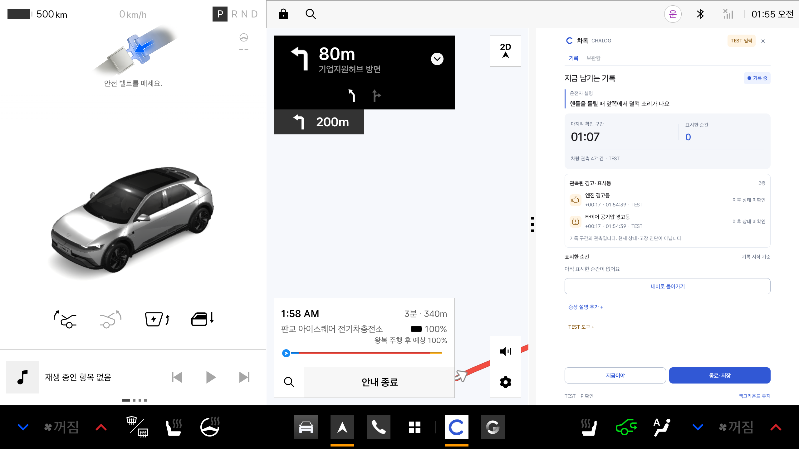

# 차록 · CHALOG

**증상이 생긴 그 순간부터, 정비사와의 대화까지.**

**[한글 자막 시연 영상 · 2분 39초](docs/evidence/macos-pleos-captioned-demo-2026-11-15/chalog-verified-scenarios-ko.mp4)** — 좌측 상단 시나리오6개·하단 한글 설명·실제 Mac Pleos TEST 화면. [영상·DB 검증](docs/20-captioned-scenario-demo.md).

영문 브랜드는 **CHALOG**, 한글 서비스명은 **차록**입니다. ‘차 + log(기록)’를 조합한 이름으로, 함께 표기해 한글 이름을 일관되게 안내합니다.

차록은 운전자가 느낀 이상 증상을 음성으로 표시하면, 실제 확보한 직전 1분부터 종료 명령까지의 차량 상태를 함께 보존하고 정비사와 검토할 수 있게 하는 서비스입니다.

**저장소·소스 이름은 CHALOG로 정리했으며 Android 0.3.2/8 검증을 진행 중입니다.** [이름 변경·호환성](docs/21-chalog-rename.md).

아래는 직전 **Android 0.3.1/7** 검증 결과입니다. 최초 동의와 매 기록 시작을 분리하고, 화면 없는 CONTROL/ADD Broadcast와 명시적 OPEN을 구현했습니다. 동의 행 조작·보고서 결과 안내를 고쳤고 SIGNAL 패널과 경고등 이력을 유지합니다. Mac Pleos 기기15개·별도 새 PID 복원과 JVM39개를 통과했습니다. 이번 수정 전 기록77개 전체를 보존했으며 시연 후 최종 DB는119개·무결성ok입니다. [12개 시나리오별 재검증](docs/19-background-fixes-and-reverification.md) · [실제 화면·APK·DB 증거](docs/evidence/macos-pleos-gleo-fixes-2026-11-15/README.md).

제품 목표는 **Gleo로 화면 없이 기록·종료하고, ‘차록 열어줘’에만 우측 콘텐츠 영역을 표시**하는 것입니다. [개발 방향](docs/15-gleo-background-direction.md) · [선택된 SIGNAL 시안](docs/design/gleo-background/README.md). TEST Broadcast/저장/복원은 확인했지만 실제 Gleo 발화·등록, 차량 SDK·마이크·음악, 자동 우측 배치·차록에서 보내는 내비 목적지는 별도 차단/미검증입니다. 결과 알림은 알림센터에서 확인했고 짧은 토스트의 실제 노출은 미확인입니다. [한국어 기능 자막을 포함한 시연](docs/20-captioned-scenario-demo.md)을 완성했으며 TEST 입력과 검증 범위를 영상에 표시했습니다.

순정 내비의 공개 장소 검색·340m 경로 안내·종료는 실제로 동작했습니다. 배경 지도는 여전히 비어 있습니다. Pleos 문서 저장 화면은 문서를 반환하지 않는 stub이므로 파일 저장 완료로 표시하지 않습니다. [브랜드·내비 조사](docs/17-chalog-and-navigation.md) · [수정 전 시나리오 검토](docs/18-service-scenario-review.md).

## Android 실행

JDK17·Android SDK35에서 `./gradlew :app:testDebugUnitTest :app:lintDebug :app:assembleDebug :app:assembleDebugAndroidTest :app:assembleRelease`로 검사·빌드합니다. debug/test APK는 개발 서명이고 release는 미서명입니다. unsigned release는 실행 가능한 제출 APK가 아닙니다.

- 이전 0.3.1 [성공 CI43701282754](https://github.com/leemh-dev/chalog/actions/runs/43701282754): JVM39·일반 Android 기기15건·새 PID 복원, [APK와 metadata artifact](https://github.com/leemh-dev/chalog/actions/runs/43701282754/artifacts/14157071359). [다운로드한 ZIP/APK·버전·개발 서명 대조](docs/evidence/macos-pleos-gleo-fixes-2026-11-15/ci-apk-crosscheck.json). Mac은 기존 개발 서명을 유지해 DB를 보존합니다.
- 0.1 기준 [성공 CI43650320801](https://github.com/leemh-dev/chalog/actions/runs/43650320801) · [APK artifact](https://github.com/leemh-dev/chalog/actions/runs/43650320801/artifacts/14136300842): 앱 코드ef85516, JVM24·기기5건·새 PID 복원 성공. [해시/서명](docs/evidence/android-v0.1/apk-metadata.json)을 대조하세요.
- [Mac Pleos 설치·실행·실제 화면 녹화 절차](docs/12-mac-pleos-handoff.md)
- 기본은 Pleos 입력/운전 상태 미확인입니다. 수동 TEST는 **입력 설정 → TEST 선택 → 동의 → 기록 준비 켜기 → 기록 시작 → TEST 도구에서 설명/순간 → 종료 → 상담 카드**로 확인합니다. 음성 명령 진입 검사는 정차 중 명시적 음성 설정 후 별도 instrumentation으로 실행하며 실제 Gleo 발화 성공과 구분합니다.
- 실제 앱은 차록 패널만 그립니다. 아래의 차량/내비 도식은 브라우저 설계 자료이며 앱 자체 기능이 아닙니다.
- 현 단계 자동 예약·원음 녹음·GDS 자동 열람은 없습니다. 기획서 제출용 DOCX는 당시 초안이며 앱 구현 결과를 자동 반영하지 않습니다.

## 실제 앱 화면

Mac Pleos · 0.3.1. 차록 입력은 TEST입니다. 차량정보 왼쪽 / 순정 내비 중앙 / CHALOG 오른쪽은 OS 수동 창 조작으로 확인했습니다.

[최신 실제 화면12장·검사·DB·APK 증거](docs/evidence/macos-pleos-gleo-fixes-2026-11-15/README.md) · [경고등 처리 원칙](docs/16-warning-light-observations.md) · [Mac 다음 실행 프롬프트](docs/13-next-development-prompt.md)

## 최신 기획과 디자인

- [공모전 기획서 v0.3](docs/07-submission-plan.md)
- [공식 접수양식 DOCX 초안](docs/submission/charok-application-draft.docx) — 개인정보·동의·서명 미작성, 제출 전 Word에서 페이지 확인 필요
- [화면 시안 및 실행 방법](docs/design/README.md) · [UX/UI 명세](docs/08-ux-ui-spec.md)
- [시연·개발 단계와 다음 실행 프롬프트](docs/09-demo-delivery-plan.md)

이번 시안은 차량·지도·음성·저장을 TEST로 표현합니다. 실제 Android·Pleos·마이크·DB 성공으로 간주하지 않습니다. 설계 이력은 docs/07~09에 보존하며, 현재 구현·검증은 docs/10~14·19와 위 실제 실행 증거를 따릅니다.

## 문서

- [기획서](docs/01-product-plan.md): 서비스 정의, 고객, 대표 시나리오, 화면, 데이터·저장·공유 원칙
- [SDK와 정비 장비 연동 분석](docs/02-sdk-feasibility.md): 확인한 API·권한, 미지원/미확인 영역, 공식 근거
- [단계별 개발·검증 계획](docs/03-development-plan.md): Cloud 구현과 Mac Pleos 검증, 시연·완료 기준
- [대화형 전체 시나리오 기술 재검토](docs/05-conversation-scenario-feasibility.md)
- [조사·의사결정 기록](docs/04-decision-log.md)
- [문서 전체 목록](docs/README.md)

## 핵심 흐름

최초 정차·동의/권한 설정 → 수집 없이 대기 → 사용자 기록 명령 → 화면 없이 기록·설명·순간 표시 → 종료·동일 ID 저장/재조회·결과 알림 → 명시적 열기 → 정차 후 상담/선택 보고서

사전 준비를 선택한 경우에만 실제 수집한 최대60초를 포함합니다. 바로 시작한 경우 없는 과거를 만들지 않습니다. 재실행 자체는 수집·마이크를 재개하지 않습니다. 실제 Gleo·차량·정비소 수신과 스캐너 조회는 별도 연동/검증 조건입니다.
