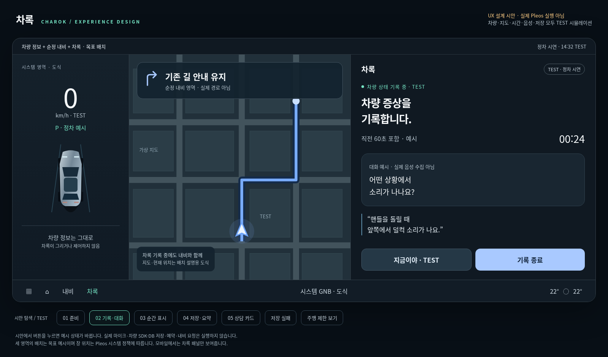

# 차록 · CHAROK

**증상이 생긴 그 순간부터, 정비사와의 대화까지.**

차록은 운전자가 느낀 이상 증상을 음성으로 표시하면, 실제 확보한 직전 1분부터 종료 명령까지의 차량 상태를 함께 보존하고 정비사와 검토할 수 있게 하는 서비스입니다.

현재는 **기획·SDK 조사 및 UX 프로토타입 단계**입니다. 공식 공모전 양식의 작품 소개 초안과 조작 가능한 브라우저 시안을 만들었습니다. Android 앱·서버·정비사 뷰어는 아직 구현하지 않았으며, Pleos SDK 실제 실행과 정비소 스캐너 연동도 미검증입니다.

## 최신 기획과 디자인

- [공모전 기획서 v0.3](docs/07-submission-plan.md)
- [공식 접수양식 DOCX 초안](docs/submission/charok-application-draft.docx) — 개인정보·동의·서명 미작성, 제출 전 Word에서 페이지 확인 필요
- [화면 시안 및 실행 방법](docs/design/README.md) · [UX/UI 명세](docs/08-ux-ui-spec.md)
- [시연·개발 단계와 다음 실행 프롬프트](docs/09-demo-delivery-plan.md)

이번 시안은 차량·지도·음성·저장을 TEST로 표현합니다. 실제 Android·Pleos·마이크·DB 성공으로 간주하지 않습니다. 현재 범위는 docs/07~09를 우선하고 이전 문서는 조사 이력으로 보존합니다.

## 문서

- [기획서](docs/01-product-plan.md): 서비스 정의, 고객, 대표 시나리오, 화면, 데이터·저장·공유 원칙
- [SDK와 정비 장비 연동 분석](docs/02-sdk-feasibility.md): 확인한 API·권한, 미지원/미확인 영역, 공식 근거
- [단계별 개발·검증 계획](docs/03-development-plan.md): Cloud 구현과 Mac Pleos 검증, 시연·완료 기준
- [대화형 전체 시나리오 기술 재검토](docs/05-conversation-scenario-feasibility.md)
- [조사·의사결정 기록](docs/04-decision-log.md)
- [문서 전체 목록](docs/README.md)

## 핵심 흐름

기록 준비 → 최근 60초 임시 버퍼 → “증상 기록해 줘” → 직전 구간 보존·기록 지속 → “종료해 줘” → 저장 확인 → 고객이 선택한 기록을 정비사와 검토

직전 1분은 사전 수집된 범위에서만 남깁니다. 수신하지 못한 과거 데이터나 미지원 필드는 만들어 채우지 않습니다. 스캐너 연결 즉시 자동 조회는 정식 연동이 필요한 확장 목표입니다.
