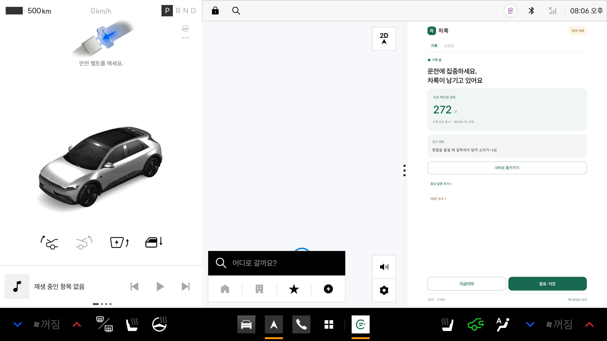

# 차록 · CHAROK

**증상이 생긴 그 순간부터, 정비사와의 대화까지.**

차록은 운전자가 느낀 이상 증상을 음성으로 표시하면, 실제 확보한 직전 1분부터 종료 명령까지의 차량 상태를 함께 보존하고 정비사와 검토할 수 있게 하는 서비스입니다.

현재 **Android 0.2.0/2의 흰색 UI와 백그라운드 기록·알림을 구현하고 Mac Pleos TEST 검증을 완료**했습니다. 순정 내비 가운데/차록 오른쪽 배치, 화면 종료 후 같은 ID 기록 유지, 알림 조작, 강제 종료 후 자동 수집 없는 복원을 확인했습니다. [실제 화면·영상·검증 결과](docs/evidence/macos-pleos-v0.2-2026-11-15/README.md)와 [0.2 동선/구현 원칙](docs/14-background-and-white-ui.md)을 참고하세요. 실제 SDK·마이크·Gleo·센터 목적지 연동은 환경 차단/미검증 상태입니다. 기획 자료와 이전 검증 이력은 보존합니다.

## Android 실행

JDK17·Android SDK35에서 `./gradlew :app:testDebugUnitTest :app:lintDebug :app:assembleDebug :app:assembleDebugAndroidTest :app:assembleRelease`로 검사·빌드합니다. debug/test APK는 개발 서명이고 release는 미서명입니다. unsigned release는 실행 가능한 제출 APK가 아닙니다.

- 최신 0.2 [성공 CI43674300468](https://github.com/leemh-dev/charok/actions/runs/43674300468): JVM24·기기8건·프로세스 복원, APK와 metadata artifact 포함.
- 0.1 기준 [성공 CI43650320801](https://github.com/leemh-dev/charok/actions/runs/43650320801) · [APK artifact](https://github.com/leemh-dev/charok/actions/runs/43650320801/artifacts/14136300842): 앱 코드ef85516, JVM24·기기5건·새 PID 복원 성공. [해시/서명](docs/evidence/android-v0.1/apk-metadata.json)을 대조하세요.
- [Mac Pleos 설치·실행·실제 화면 녹화 절차](docs/12-mac-pleos-handoff.md)
- 기본은 Pleos 입력/운전 상태 미확인입니다. 일반 Android에서는 **입력 설정 → TEST 선택 → 준비 동의 → 준비 켜기 → 기록 시작 → TEST 도구에서 설명/순간 → 종료 → 상담 카드**로 확인합니다.
- 실제 앱은 차록 패널만 그립니다. 아래의 차량/내비 도식은 브라우저 설계 자료이며 앱 자체 기능이 아닙니다.
- 현 단계 자동 예약·원음 녹음·GDS 자동 열람은 없습니다. 기획서 제출용 DOCX는 당시 초안이며 앱 구현 결과를 자동 반영하지 않습니다.

## 실제 앱 화면

Mac Pleos · 0.2.0 · TEST 입력. OS의 순정 내비를 가운데, 차록을 오른쪽에 배치했습니다. 차량 SDK·실제 마이크 수신이나 목적지 경로 안내 성공을 뜻하지 않습니다.

[0.2 화면·알림·영상·검증 증거](docs/evidence/macos-pleos-v0.2-2026-11-15/README.md) · [이전 0.1 일반 Android 화면과 검사 이력](docs/evidence/android-v0.1/README.md) · [Mac 다음 실행 프롬프트](docs/13-next-development-prompt.md)

## 최신 기획과 디자인

- [공모전 기획서 v0.3](docs/07-submission-plan.md)
- [공식 접수양식 DOCX 초안](docs/submission/charok-application-draft.docx) — 개인정보·동의·서명 미작성, 제출 전 Word에서 페이지 확인 필요
- [화면 시안 및 실행 방법](docs/design/README.md) · [UX/UI 명세](docs/08-ux-ui-spec.md)
- [시연·개발 단계와 다음 실행 프롬프트](docs/09-demo-delivery-plan.md)

이번 시안은 차량·지도·음성·저장을 TEST로 표현합니다. 실제 Android·Pleos·마이크·DB 성공으로 간주하지 않습니다. 설계 이력은 docs/07~09에 보존하며, 현재 구현·검증은 docs/10~14와 위 실제 실행 증거를 따릅니다.

## 문서

- [기획서](docs/01-product-plan.md): 서비스 정의, 고객, 대표 시나리오, 화면, 데이터·저장·공유 원칙
- [SDK와 정비 장비 연동 분석](docs/02-sdk-feasibility.md): 확인한 API·권한, 미지원/미확인 영역, 공식 근거
- [단계별 개발·검증 계획](docs/03-development-plan.md): Cloud 구현과 Mac Pleos 검증, 시연·완료 기준
- [대화형 전체 시나리오 기술 재검토](docs/05-conversation-scenario-feasibility.md)
- [조사·의사결정 기록](docs/04-decision-log.md)
- [문서 전체 목록](docs/README.md)

## 핵심 흐름

기록 준비 → 최근 60초 임시 버퍼 → “증상 기록해 줘” → 직전 구간 보존·기록 지속 → “종료해 줘” → 저장 확인 → 고객이 선택한 기록을 정비사와 검토

직전 1분은 사전 수집된 범위에서만 남깁니다. 수신하지 못한 과거 데이터나 미지원 필드는 만들어 채우지 않습니다. 스캐너 연결 즉시 자동 조회는 정식 연동이 필요한 확장 목표입니다.
