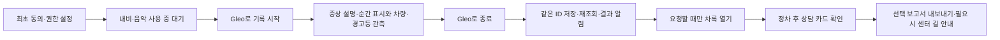

# 차록 · CHALOG 전체 서비스 시나리오 검토

이 문서는0.2.3 수정 전 검토 이력입니다. 후속0.3.1에서 Broadcast/OPEN·동의·보고서 피드백을 구현하고 같은12개 기준으로 다시 검사했습니다. [최신 수정과 재검증](19-background-fixes-and-reverification.md)을 먼저 확인합니다.

검토 기준: docs/15의 Gleo 중심 백그라운드 제품 방향, 앱 0.2.3/5 · 코드 1ed571d, 기존 Mac Pleos 2.1.0 AVD. 이번 작업은 시나리오 대조와 실행 검토이며 앱 기능을 추가하는 작업이 아닙니다.

## 전체 서비스 흐름

화면은 평소 왼쪽 차량정보 / 오른쪽 전체 내비 또는 중앙 내비·우측 음악입니다. 기록 시작·설명·표시·종료는 기존 화면을 유지하고, 명시적 열기에서만 차록이 우측 콘텐츠 패널을 사용해야 합니다. 준비된 과거는 실제 수집한 최대60초만 포함합니다. 앱 재실행 뒤 자동 수집·마이크 재개를 하지 않으며, 자동 예약·업체 수신·고장 진단은 이번 서비스 완료 범위가 아닙니다.

## 번호순 시나리오와 판정 기준

| 번호 | 사용자 행동/상황 | 통과 기준 | 실제 입력 구분 |
| --- | --- | --- | --- |
| 01 | 최초 동의 또는 재실행 | 미동의 수집 없음, 실제 차량 상태 미확인 시 준비/상세 잠금, 자동 재개 없음 | 기존 설치 재실행·실제 SDK 상태. 데이터 초기화로 첫 설치를 만들지 않음 |
| 02 | 내비·음악으로 평소 사용 | 차록 미노출, 내비/음악 정상 유지 | 순정 앱. 재생 중인 음악이 없으면 재생 유지 성공으로 세지 않음 |
| 03 | “차록 기록해줘”, 반복 시작 | 앱 화면 없이 기록 시작, 같은 ID, 불필요한 재질문 없음 | Gleo 실제 발화와 ADB Intent 진입 검사 구분 |
| 04 | 사전 수집 후 기록 시작 | 실제 받은 최대60초만 같은 기록에 포함, 더 오래된/없는 관측 생성 금지 | TEST 데이터로 버퍼·DB 검증 |
| 05 | 증상 설명, “지금이야” | 원문·출처·시각을 보존하고 표시가 같은 기록에 연결 | TEST 버튼/알림과 STT/Gleo 구분 |
| 06 | 경고등 점등→소등·수신 끊김 | 최초 관측·점멸·소등 이력 보존, 미수신을 정상으로 바꾸지 않음 | TEST 경고 입력과 Vehicle getter 수신 구분 |
| 07 | 화면 닫기·주행 상태 | 백그라운드 관측 지속, 상세/내보내기 잠금, 종료는 가능 | OS 창·서비스·DB와 앱 TEST 주행 상태 구분 |
| 08 | 기록 종료 | 수집 중지→동일 ID commit/재조회→결과 알림, 대시보드 자동 표시 없음 | 알림 종료와 Gleo 실제 종료 구분 |
| 09 | “차록 열어줘” | 새 기록 없이 기존 기록 표시, 우측만 사용 | 명시적 Gleo Action과 런처/OS 수동 배치 구분 |
| 10 | 정차 후 상담/선택 보고서 | 설명·표시·경고등·관측이 DB와 일치, 선택한 범위만 생성 | 파일 생성과 실제 외부 수신 구분 |
| 11 | 실제 센터로 길 안내 | 차록 요청·콜백·순정 목적지 일치 | SDK 경로와 순정 내비 공개 POI 직접 조작 구분 |
| 12 | 중복·저장 실패·프로세스 종료 | 중복 시작은 동일 ID, 실패 후 동일 ID 재시도, 중단 기록 복원·자동 수집 없음 | 실제 DB와 별도 instrumentation/새 PID 검사 |

## 코드에서 확인한 제품 흐름의 차이

1. **P1 · 화면 없는 최초 기록 시작이 없음.** `RecorderModel.arm()`은 foreground·정차·동의를 요구하고, `gleo()` 시작은 ARMED/RECORDING 상태만 받습니다. 한 번 설정한 뒤 매번 Gleo로 바로 시작한다는 최신 목표를 충족하지 못합니다. 재실행 후 자동 수집 금지와 사용자 음성으로 새 수집 시작은 별개의 동작이어야 합니다.
2. **P1 · 시작/종료와 명시적 화면 열기가 분리되지 않음.** schema의3함수 모두 `component: activity`이며 `OPEN_CHAROK_RECORDS`/BroadcastReceiver가 없습니다. 투명 Activity 진입을 최종 service/Broadcast 경로로 간주할 수 없습니다. 시작하지 않은 상태의 직접 Intent가 기록을 만들지 않는 것은 안전한 거절이지, Gleo 사용자 시나리오의 성공이 아닙니다.
3. **P1 · 우측 전용 열기/기존 음악 배치 복귀는 미구현.** MainActivity의 일반 실행과 알림 contentIntent만 있고 우측 지정 동작은 없습니다. [공식 Window Policy](https://document.pleos.ai/docs/connect/guide/docs-design/getting-started/window)의 OS 배치와 수동 창 교환을 실제 자동 동작으로 기록하지 않습니다.
4. **실제 연동 차단을 TEST 성공으로 대체하지 않음.** 차량 상태·경고등 SDK, 실제 마이크, Gleo 발화, 차록 NaviHelper 목적지 요청은 별도 증거가 필요합니다. 기존 흰 배경 지도는 순정 내비의 경로선/회전 안내 동작과 분리합니다.

[공식 Gleo 예제](https://document.pleos.ai/docs/pleos-only/app-integration-guide/guide/examples)는 `component: service`를 Broadcast 전달/Receiver 수신으로 설명합니다. 후속 수정은 이 전달 방식, 정상 발신자/권한 경계, FGS 시작 조건과 실제 Gleo 등록을 함께 검증해야 합니다. 검토 중 인증·권한·운전 상태 잠금을 우회하지 않습니다.

## 실행 판정

**전체 목표 시나리오는 아직 완료되지 않았습니다.** 현재 검증 가능한 중심은 ‘앱에서 명시적으로 TEST 준비 → 알림 기록/표시/종료 → 저장/상담/보고서’입니다. Gleo 중심 진입과 자동 우측 열기를 이 대체 경로로 통과 처리하지 않습니다.

| 번호 | 판정 | 이번 실행 결과 |
| --- | --- | --- |
| 01 | 안전 제한 확인 / 최초 설정 일부 미검증 | 기존66개·서비스 없음으로 시작. 실제 입력에서 기어/속도 미확인, 준비/상세 잠금. 초기 설치/권한 거절을 데이터 초기화로 재현하지 않음 |
| 02 | 부분 확인 | 순정 공개 충전소340m 안내와 차록 화면 없음 확인. 배경 지도는 미해결. 음악 세션은 Bluetooth 연결 해제 ERROR 상태라 재생 유지 미검증 |
| 03 | 목표 미충족 | 준비 없는 기존3 Action 직접 호출 후66개 그대로·FGS 없음. OPEN Action은 resolve되지 않음. 실제 Gleo 발화는 검증하지 못했으며 현재 코드가 수동 준비를 요구 |
| 04 | TEST 통과 | 오래 준비해도 시작 시 실제 직전59.23초만 포함. 없는 과거/60초보다 오래된 관측 생성 없음 |
| 05 | TEST 통과 | 증상 버튼 원문1건과 알림 ‘지금이야’1건을 같은 ID에 저장. 실제 STT/Gleo 발화 성공이 아님 |
| 06 | TEST 통과 / 실제 SDK 미검증 | ENGINE ON→OFF, TPMS BLINK, 조회 실패를 기록. 두 항목 모두 ‘이후 상태 미확인’ 표시, 과거 점등·소등 원시 관측은 보존 |
| 07 | TEST 통과 / 실제 차량 상태 차단 | 화면 없는 동일 ID 관측256→292건. TEST 주행에서 상세 잠금, 알림 종료 가능. 실제 Console 기어/속도 조작 성공이 아님 |
| 08 | TEST 알림 경로 통과 | 동일 ID SAVED, 관측763→763건으로 정지. FGS 없음·대시보드 없음·순정 안내 유지. 알림센터의 저장 문구 확인, 짧은 heads-up 배너는 별도 미검증 |
| 09 | 일부 확인 / 우측·음성 목표 미충족 | 명시적 앱 재열기로 같은 저장 기록 유지. 일반 실행은 전체 앱 영역을 사용하며 자동 우측 고정은 없음. ‘차록 열어줘’ 전용 Action 없음 |
| 10 | 로컬 파일 통과 / 전달 차단 | 상담 카드·TXT/JSON의 설명2·순간1·관측763건과 DB 일치. 공유 chooser에 수행 가능한 앱이 없어 외부 전달/수신 미검증 |
| 11 | 순정 직접 조작만 확인 | 공개 POI 검색·경로 안내·종료 확인. 실제 차량 상태 미확인/TEST 입력에서는 차록의 SDK 센터 요청을 실행하지 않음 |
| 12 | TEST 기기 검사 통과 | 9개 메서드 각각 통과, 별도 프로세스 종료/복원 통과. 같은 ID의 중단 기록·설명 2건·순간 1건·관측 4건 보존, 직접 재열기 후에도 수집 재개 없음 |

현재 앱 상태의 재현이지 실차 검증이 아닙니다. 이번 no-audio 실행에서 실제 마이크·음성 안내를 검사했다고 표시하지 않습니다. Gleo 앱의 리마인더 화면이 열리는 것과 차록 Action 등록·발화 매핑 성공도 구분합니다.

## 다음 수정 우선순위

1. 최초 동의/권한 상태와 매 기록 시작을 분리하고, 사용자 Gleo 명령에서 정상 백그라운드 수집을 시작할 수 있는 경로를 구현·검증합니다. 재실행 자체는 계속 자동 수집을 금지합니다.
2. CONTROL/ADD/OPEN 세 의도로 schema를 재구성하고, 시작·표시·종료는 공식 Broadcast 경로, 열기만 Activity로 분리합니다. 실제 등록과 한국어 발화로 재검증합니다.
3. 공식 OS 정책 안에서 우측 열기와 이전 콘텐츠 복귀를 확인합니다. 불가능한 조건이면 제품 동작에 제한을 명시합니다. 수동 배치로 완료를 주장하지 않습니다.
4. 실제 차량 연결·마이크·음악 재생·짧은 알림 배너·공유 수신 앱을 갖춘 환경에서 같은12개 시나리오를 다시 실행합니다. 순정 지도 배경 문제는 독립 조사합니다.

코드 검토 위치: [Gleo 준비 조건](https://github.com/leemh-dev/chalog/blob/324125b50b39278726264b09dd208be68535051f/app/src/main/java/dev/leemh/charok/RecorderModel.kt#L230), [foreground 준비 조건](https://github.com/leemh-dev/chalog/blob/324125b50b39278726264b09dd208be68535051f/app/src/main/java/dev/leemh/charok/RecorderModel.kt#L162), [현재 schema](https://github.com/leemh-dev/chalog/blob/324125b50b39278726264b09dd208be68535051f/app/src/main/assets/schema.json#L6), [일반 Activity/공유 진입](https://github.com/leemh-dev/chalog/blob/324125b50b39278726264b09dd208be68535051f/app/src/main/java/dev/leemh/charok/MainActivity.kt#L28).

## 검사와 보존 결과

Mac Pleos 기기 검사 9개 메서드 개별 실행과 별도 새 PID 복원을 통과했습니다. 기존 66개 전체 행 보존 · 최종 77개 · 무결성 ok입니다. [실제 화면 11장·수동 수치·보고서·기기 검사·DB 보존 증거](evidence/macos-pleos-scenario-2026-11-15/README.md). 새 기능 구현·APK 빌드·영상·자동 병합은 수행하지 않았습니다.
