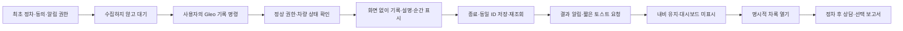

# 차록 0.3.1 · 백그라운드 흐름 수정과 재검증

앱 **0.3.1/7 · 검증 코드 8c8f793**, `feat/charok-recorder`. [이전 12개 시나리오 검토](18-service-scenario-review.md)의 앱 구현 차이를 수정하고 같은 기준으로 다시 검사했습니다. **TEST로 확인한 앱 동작과 실제 Gleo/차량 연동은 별개입니다. 전체 실차 서비스 완료 판정은 하지 않습니다.** 최종 커밋은 검사 코드 수정이며, 수동 시나리오에 사용한 7ad2e81과 설치 앱 SHA-256이 동일합니다.

## 전체 흐름

사전 준비는 선택 경로입니다. 준비한 경우 실제 받은 최대 60초만 보존하고, 바로 시작한 경우 없는 과거를 만들지 않습니다. 앱 재실행 자체는 수집/마이크를 켜지 않습니다.

## 수정한 내용

- 최초 동의와 매번 수동 준비를 분리했습니다. 실제 입력 동의는 버전과 함께 보관하고 TEST 동의는 해당 프로세스에만 둡니다. 명령을 받기 전에는 수집하지 않습니다.
- 공식 `component: service`의 Broadcast로 CONTROL/ADD를 받고, 명시적 OPEN만 Activity로 분리했습니다. 세 함수 제한을 지키며 JSON/개별 매개변수, 타입·길이 검사, 중복 시작·종료, 콜백, 시작 제한시간과 FGS 실패를 처리합니다. 명령에서 동의/입력 모드를 바꿀 수 없습니다.
- Receiver는 플랫폼 `BIND_VOICE_INTERACTION` 권한을 요구합니다. 설치된 Gleo 클라이언트 `ai.umos.ambientai`의 해당 권한 보유를 확인했고, 별도 비권한 TEST 앱의 호출은 차단됐습니다. **실제 Gleo 발신 프로세스·schema 등록·한국어 발화 매핑은 아직 확인되지 않았습니다.** 이 경계 검사를 음성 연동 성공으로 바꾸지 않습니다.
- 화면이 닫힌 동안 시작/표시/저장 결과에 일반 Android 짧은 텍스트 토스트 API와 상태 알림을 사용합니다. 이 Pleos에서는 토스트가 실제 표시된 증거를 확보하지 못했고, 알림센터 표시·내용·만료를 확인했습니다. 알림에는 증상 원문을 넣지 않으며 결과 알림은 8초 후 만료됩니다. 전체화면·오버레이·음악 오디오 포커스를 요청하지 않습니다.
- 동의 행 전체를 누를 수 있게 했고, 보고서 생성·공유/파일 저장 결과를 정차 중에도 보이도록 고쳤습니다. 저장 취소/지원되지 않는 화면은 성공으로 표시하지 않습니다. 선택 파일만 별도 TEST 수신 UID에서 읽고 다른 파일 접근은 거절되는지 검사했습니다.
- 우측 창을 만들려던 portrait 설정은 실제로 검은 여백을 만들어 제거했습니다. 앱은 창 크기에 맞춰 표시하고, 우측 배치는 OS 수동 조작으로만 확인했습니다. 공개 API로 자동 우측 지정을 완료했다고 주장하지 않습니다.

## 번호순 재검증 결과

| 번호 | 시나리오 | 결과 |
| --- | --- | --- |
| 01 | 최초 동의·재실행 | 미동의/변조된 명령 거절, 동의만으로 수집 안 함, 재실행/새 PID에서 자동 수집 없음. 실제 차량 상태 미확인 잠금 유지 |
| 02 | 내비·음악 유지 | 순정 공개 POI 340m 안내와 차록 비노출 유지. 음악은 Bluetooth 연결 해제 ERROR·no-audio이므로 재생/소리 유지 미검증 |
| 03 | 시작·반복 시작 | TEST Broadcast로 수동 준비 없이 화면 없는 시작·같은 ID 중복 처리 통과. 실제 Gleo 발화/등록은 미검증 |
| 04 | 사전 구간 | 수동 TEST 흐름의 실제 직전 59.815초 보존. 바로 시작하는 새 경로는 시작 이전 관측을 만들지 않음 |
| 05 | 설명·지금이야 | TEST 설명 1건+순간 1건, 같은 ID·출처 보존. 실제 마이크 STT/TTS 성공 아님 |
| 06 | 경고등 | TEST ENGINE ON→OFF·TPMS BLINK·수신 끊김 보존, 이후 미확인 표시. 실제 SDK 수신은 미검증 |
| 07 | 화면 닫기·주행 제한 | 화면 없는 관측 485→539건. 별도 기기 검사에서 TEST 주행 상세/내보내기 잠금과 종료 가능 확인 |
| 08 | 종료·결과 표시 | 같은 ID SAVED, 547→547건으로 수집 정지, FGS/대시보드 없음. Broadcast 상태 알림 생성·만료 확인, 토스트 실제 노출은 미확인 |
| 09 | 명시적 열기 | OPEN으로 기존 기록만 표시·새 기록 없음. 자동 우측 지정은 미완료, 실제 오른쪽 화면은 OS 수동 배치 |
| 10 | 상담·보고서 | DB와 TXT/JSON 대조, 별도 TEST UID 수신·선택 외 파일 거절 통과. Pleos 문서 저장 stub은 문서를 반환하지 않아 저장 안 됨을 표시. 실제 정비소 수신 아님 |
| 11 | 센터 안내 | 순정 내비 직접 검색·안내·종료만 확인. 차량 상태 미확인에서 차록 SDK 목적지 제한을 우회하지 않음 |
| 12 | 중복·저장 실패·프로세스 종료 | 같은 ID 재시도, 빠른 중복·오래된 알림 거절, 새 PID에서 INTERRUPTED/관측 불변·자동 재개 없음 통과 |

## 검사·보존·남은 조건

Mac JVM **39개**, lint **오류0/경고14**, 실제 Pleos 기기 **15개**와 별도 새 PID 복원 통과. [CI43701282754](https://github.com/leemh-dev/charok/actions/runs/43701282754)도 JVM39·일반 Android 기기15·새 PID 복원을 통과했습니다. CI APK 3개를 내려받아 archive/APK 해시·버전·개발 인증서·미서명 release를 metadata와 대조했습니다. 기존 설치와 서명이 같은 Mac APK로 업데이트했습니다.

최초 **77개 모든 행(id/startedAt/payload) 보존**, 최종 **118개**, 추가 **41개는 모두 TEST**, schema1·무결성ok. 실패한 검사에서 만든 TEST 기록도 삭제하지 않았습니다. 외장 SSD·기존 AVD 한 대를 사용했고 빌드 중에는 AVD를 종료했습니다. 테스트 안내와 서비스를 종료한 뒤 AVD를 정상 종료했습니다. 새 영상·자동 병합·데이터 초기화·인증 우회는 없습니다.

남은 실제 연동 조건은 Console 차량 브리지/DDS 활성화, 정상 Gleo 등록과 발신 권한·한국어 발화, 실제 마이크·음악, 차록 Navi 요청/콜백, 자동 우측 배치와 짧은 결과 토스트의 실제 노출입니다. 순정 지도 바탕도 여전히 비어 있습니다. TEST 상태나 수동 창 조작을 이 항목의 성공 증거로 사용하지 않습니다.

[실제 화면·APK/CI·기기 결과·실패와 해결·DB 보존 증거](evidence/macos-pleos-gleo-fixes-2026-11-15/README.md)

공식 근거: [Gleo Broadcast 예제](https://document.pleos.ai/docs/pleos-only/app-integration-guide/guide/examples), [세 함수/schema 계약](https://document.pleos.ai/docs/pleos-only/app-integration-guide/guide/app-capability), [콜백](https://document.pleos.ai/docs/pleos-only/app-integration-guide/guide/action_callback), [schema 전달/승인](https://document.pleos.ai/docs/pleos-only/app-integration-guide/guide/deliver-schema), [Pleos 창 정책](https://document.pleos.ai/docs/connect/guide/docs-design/getting-started/window). 실제 실행 결과가 공개 설계 설명과 다른 경우 실행 관측을 별도로 남겼습니다.
