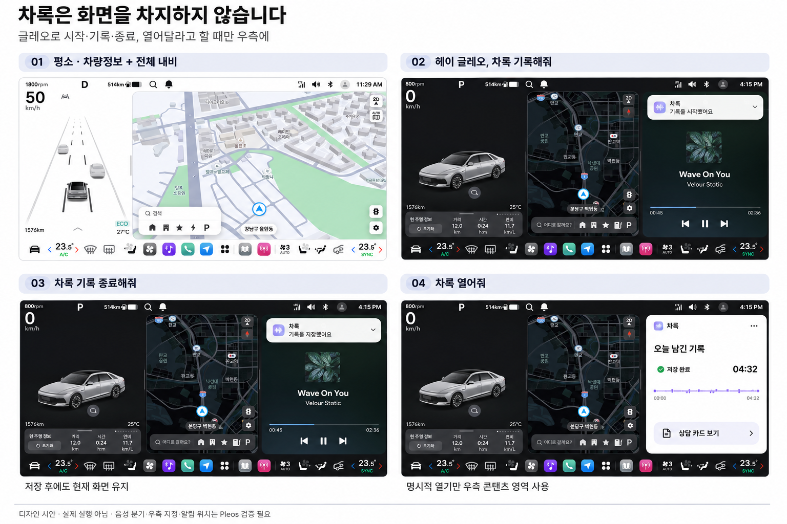
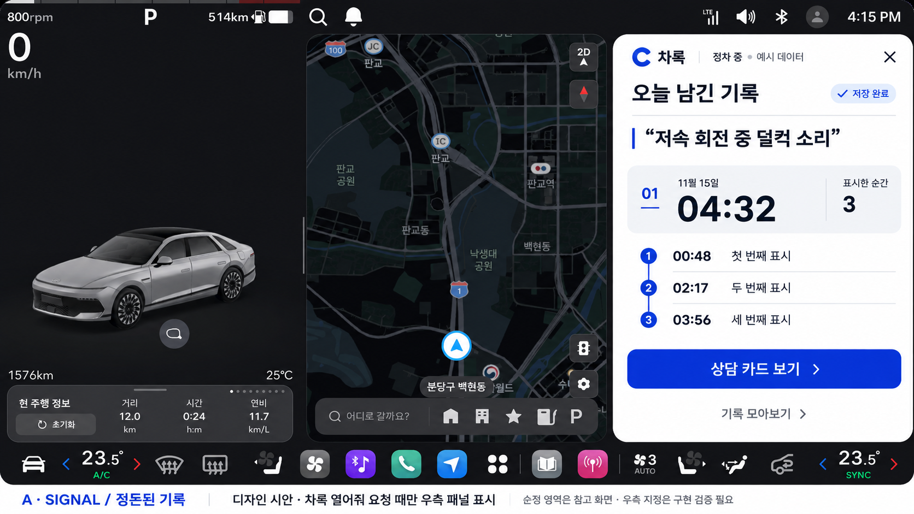
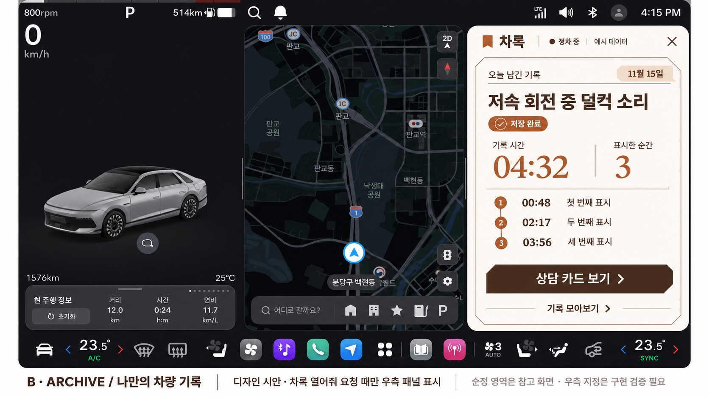
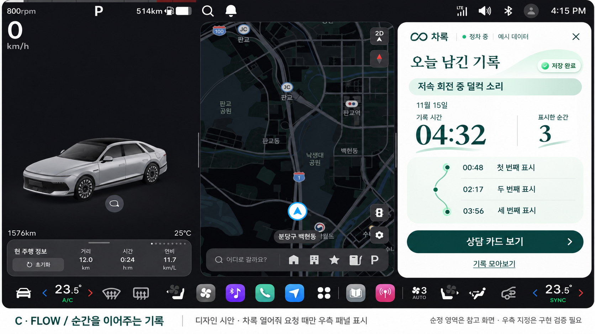

# Gleo 중심 차록 · 화면을 유지하는 기록

2026-11-15 사용자 정정을 반영한 **디자인 제안**입니다. 앱 구현과 실제 실행 증거가 아닙니다. [개발 방향](../../15-gleo-background-direction.md)을 먼저 읽습니다.

평소에는 왼쪽 차량정보와 오른쪽 전체 내비, 또는 왼쪽 차량정보·중앙 내비·오른쪽 음악/콘텐츠를 유지합니다. Gleo로 기록을 시작하고 종료할 때 차록 대시보드는 나타나지 않습니다. 명시적으로 ‘차록 열어줘’라고 했을 때만 우측 앱 패널을 사용하는 것이 목표입니다. 알림 위치와 우측 창 지정은 후속 구현 검증 항목입니다.

## 화면 흐름

01은 전체 내비 사용 예, 02~04는 내비+음악을 사용하는 별도 예입니다. 사진의 주행값·시계·지도는 공식 참조 이미지의 맥락이며 연속 주행 녹화가 아닙니다. 02의 시작과 03의 저장 뒤에도 음악 패널이 남습니다. 04에서만 해당 공간을 차록이 사용합니다. 음악 패널의 교체가 음악 재생 중지를 의미하지 않습니다.

## 우측 패널 비교

세 안 모두 같은 시스템 구조에서 차록 패널만 변경했습니다. 왼쪽 차량정보·중앙 순정 내비·공통 상태/공조 바는 공식 참조 화면의 맥락을 유지했습니다. 이미지 생성 결과이므로 픽셀 단위 일치나 시스템 UI 인증을 의미하지 않습니다. 차록의 앱 바탕은 흰색입니다.

| 안 | 특징 | 비교 기준 |
| --- | --- | --- |
| A · SIGNAL | 코발트 강조색, 큰 기록 시간, 직선 타임라인 | 좁은 우측 패널에서 가장 빠르게 읽히는 기본 추천 |
| B · ARCHIVE | 구리색, 기록지 프레임, 날짜·설명의 우선순위 | 차량 기록 노트의 개성과 보관함 정체성 |
| C · FLOW | 녹색 계열, 곡선으로 연결한 순간 표시 | 차록의 부드러운 인상과 시각적 차별화 |

시안의 숫자와 설명은 예시 데이터입니다. 타임라인 선은 기록 시점 표현이며 음성 원음이나 진단 파형이 아닙니다. 글꼴·아이콘·줄바꿈은 시안 선택 후 실제 우측 창 크기에서 별도로 다듬습니다.

## 원본과 생성 정보

- 내장 `image_gen.imagegen` 도구로 공식 화면을 참조해 생성했습니다. CLI/API fallback은 사용하지 않았습니다.
- [사용한 전체 프롬프트](prompts.json), [파일 해시](assets.json).
- 공식 참조: [현대차 Pleos 미디어킷](https://www.hyundai.com/worldwide/en/newsroom/detail/0000001168), [차량정보·내비·음악 화면](https://www.hyundai.com/content/dam/hyundai/ww/en/images/newsroom/news-image/2026/04/0430-1/media-kit/mk01.png), [차량정보·전체 내비 화면](https://www.hyundai.com/content/dam/hyundai/ww/en/images/newsroom/news-image/2026/04/0430-1/media-kit/mk02.png).
- 공식 사진 속 순정 UI와 지도는 현대차/Pleos의 참조 자료이며 차록이 구현한 기능으로 표시하지 않습니다. 생성된 이미지는 참조 사진을 기반으로 한 제안이며 공식 현대차 시안이 아닙니다.
- 이번 변경에는 Android 소스·schema·manifest·빌드·APK·DB 변경이 없습니다. 향후 실제 Gleo 동작과 앱 위치 지정은 [docs/15](../../15-gleo-background-direction.md)의 완료 기준으로 검증합니다.
