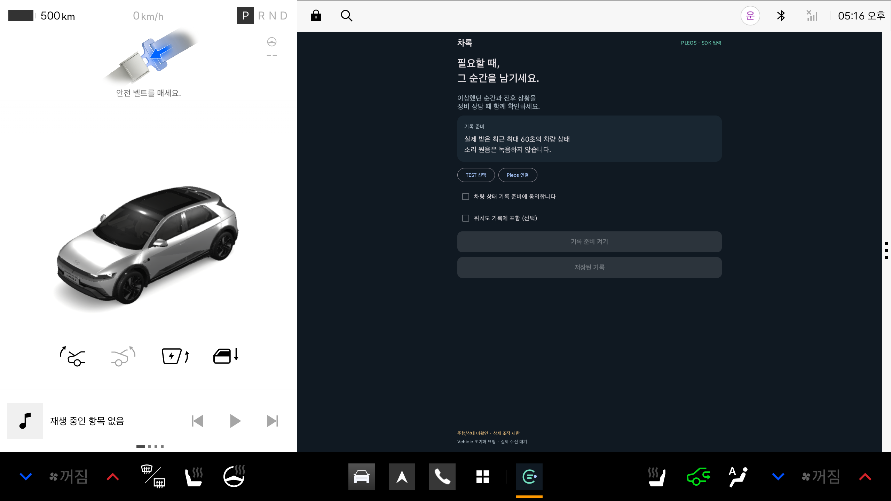
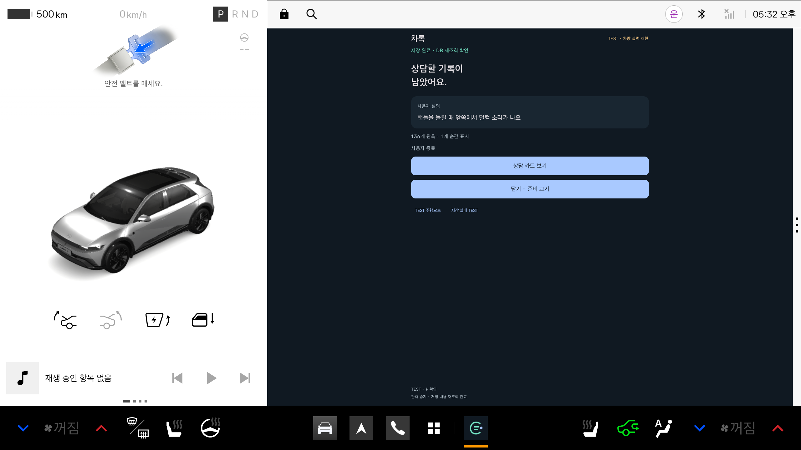
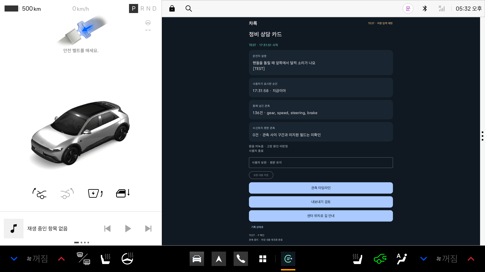
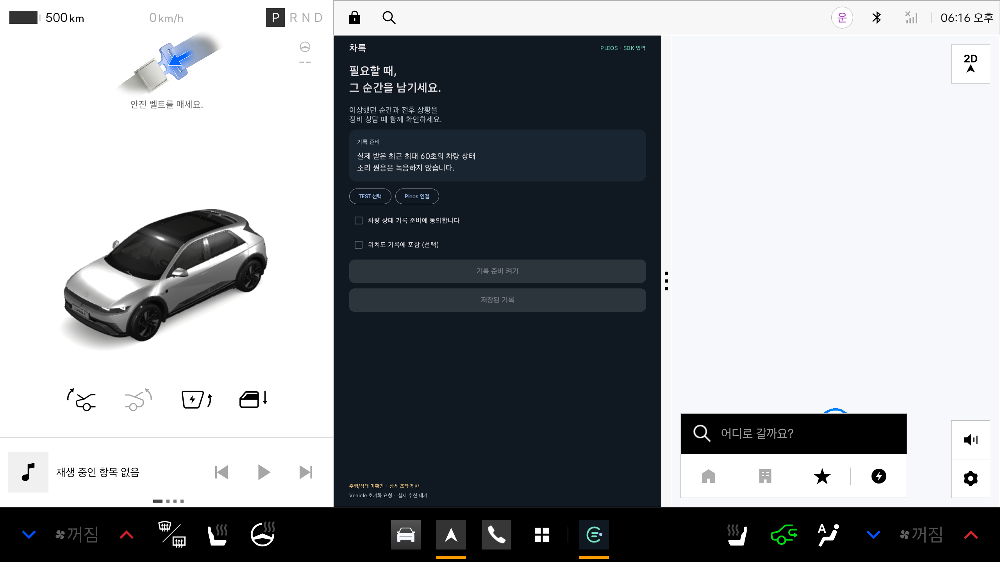

# Mac Pleos 실행 검증 · 2026-11-15

M1 8GiB에서 Pleos 실제 앱의 TEST 기록·저장·복원을 확인했습니다. 입력 출처는 TEST이며 실차 데이터나 실제 마이크 발화가 포함되지 않습니다. 실제 SDK 연결은 아래 환경 오류로 차단됐습니다.

## 코드와 APK

- 기준 CI43650320801의 코드 ef85516, 앱 0.1.0/1. artifact ZIP SHA-256은 `3f79ecef04b02233ffa4bcc5c60cd3a37f9c5e6eb8b3cb4d71b3f88341b37676`입니다. artifact metadata와 저장소 metadata의 코드·APK 항목, 실제 APK 세 개의 해시·버전·개발 인증서/unsigned 여부를 대조했습니다. [대조 결과](apk-crosscheck.json)
- 기준 debug APK는 설치됐지만 최초 실행과 재실행에서 Compose `IntStack.peek2`의 `ArrayIndexOutOfBoundsException`이 발생했습니다. 초기 로딩의 `return@Column`을 조건 분기로 바꾼 b6b7e77에서 정상 첫 화면과 후속 기기 검사를 확인했습니다. [크래시](initial-compose-crash.txt)
- Mac 수정 APK는 0.1.0/1이며 로컬 개발 서명입니다. CI 개발 서명과 달라 새 차록 전용 AVD를 생성했습니다. [Mac APK metadata](mac-apk-metadata.json)

## 환경과 실행

외장 USB APFS 볼륨 약 1.7TB 여유, 기존 SSD SDK·Pleos ARM64 API34 이미지·Emulator 37.3.9·Platform Tools 37.0.3·Build Tools 35·JDK17을 사용했습니다. 기존 AVD에서 기준 APK를 검사한 후 정상 종료하고, 수정본은 차록 전용 AVD 한 대에서 검사했습니다. 각 실행은 RAM4GiB·4코어·HVF·host GPU·cold boot·`-no-snapshot -no-audio`입니다. 초기 swap 약2.7GiB, 기존 AVD 설치 중 약4.15GiB를 관측했습니다. 로컬 빌드는 AVD 종료 후 작업자1개·Gradle heap1536MiB로 수행했습니다.

ADB transport=device, boot=1, package/activity found와 각 rc0을 확인하고 설치 직전 두 번 재검사했습니다. 차록 전용 AVD도 동일 준비 검사를 통과했습니다. 현재 Android 사용자는10입니다. 사용자 DB와 기존 AVD를 보존했으며 인증 키 복사·보안 우회·데이터 초기화는 수행하지 않았습니다. 게스트 시계는 호스트와 차이가 있어 게스트 기록 시각을 그대로 보존했습니다.

## 실제 결과

| 항목 | 결과와 증거 |
| --- | --- |
| Mac 빌드 | JVM24건, lint 오류0·경고14, debug/test 빌드 성공 |
| Pleos TEST 기능 | 기기5건 통과. 기록/순간/DB재조회, 동일ID 저장 실패 재시도, 주행 상세 잠금, Activity 재생성·background 중단, 연속 명령. [결과](device-tests.txt) |
| 프로세스 복원 | 별도 seed를 호스트에서 force-stop 후 새 프로세스 검증1건 통과. 동일ID·설명2건·INTERRUPTED·관측 증가 없음. seed는 의도적으로 종료했으므로 완료된 테스트로 세지 않음. [복원 결과](process-restore.txt) |
| 수동 TEST 흐름 | 동의→20초 이상 실제 준비→시작→TEST 설명→지금이야→종료→상담 카드. 관측136건·순간1건 |
| SQLite | 무결성 ok, 기록8개 보존. 복원ID 확인 및 내보낸 JSON과 해당 SQLite payload의 전체 일치. [검증](final-sqlite-summary.json) |
| 보고서 | 위치 제외 JSON·텍스트 생성·재조회 성공. [JSON](export-report.json) · [텍스트](export-report.txt) |
| 실제 수신 | 공유 UI에 사용할 앱이 없다는 안내. 상대 수신 미검증 |
| OS 창 배치 | 창 손잡이를 드래그해 순정 차량 영역·차록·순정 내비 동시 표시 성공. 앱 자체에서 시스템 영역을 그리지 않음 |
| AAOS·Vehicle | 정상 권한 승인 후에도 상태 미확인. Console gear bridge_ready=false, DDS 준비 모두false. P/속도0 요청은 emulator_inactive. VHAL SecureStorage RPC Permission denied 로그. 조향·브레이크·공조 실제 수신 미검증. [Console](console-readiness.json) · [차단 근거](sdk-blocker.txt) |
| 실제 마이크 STT·TTS | 기존 CoreAudio watchdog 이력에 따라 no-audio 실행. 현재 실제 음성 입력·출력 미검증. 차량 상태 잠금으로 앱 음성 준비 진입도 차단 |
| Gleo 시작·설명·종료 | model provider/CaaS 서비스 존재만 확인. 실제 발화와 세 Action 전달·응답은 각각 미검증 |
| 센터 내비 | 순정 내비 동시 표시는 확인. 실제 차량 상태 미확인으로 센터 요청 진입 차단. 좌표 입력·SDK callback·목적지 핀 미검증 |

## 실제 화면

## 다음 실행

차록 전용 AVD와 Mac 개발 서명 APK를 이어 사용합니다. 기존 CI APK 설치 AVD에는 서명이 다른 수정본을 덮어쓰기 위해 앱을 제거하지 않습니다. 공식 지원 경로에서 Console/VHAL 비활성·SecureStorage 오류를 해결한 뒤 P/0 수신, Vehicle 필드별 시각, 실제 마이크 STT·TTS, Gleo 세 Action, 공식 센터 좌표의 요청·callback·핀을 재검증합니다. 보안 설정 변경이나 반복 부팅으로 차단을 우회하지 않습니다.

공식 절차는 [Virtual Console](https://document.pleos.ai/docs/connect/guide/getting-started/application-development/use-vehicle-emulator), [마이크와 cold boot](https://document.pleos.ai/docs/connect/guide/getting-started/application-development/configure-pleos-connect-emulator)를 참고했습니다.

## TEST 시연 영상

[실제 Pleos TEST 녹화 · 89.6초](charok-pleos-test-demo.mp4) · [영상 metadata](video-metadata.json). 전체 OS 화면을 screenrecord로 녹화했습니다. 앱의 TEST 표시는 영상 동안 유지되며 준비→기록→TEST 설명→순간 표시→저장→상담 카드 순서입니다. 녹화 세션은 관측172건·설명과 순간2건이며 앞선 수동 검증의136건과 별개입니다. 무음 영상이며 실제 마이크·Gleo·차량 SDK 성공을 포함하지 않습니다. 원본은 private-evidence에 보존했고 0/15/30/45/60/75/88초 프레임을 검토했습니다.

수정본 [CI43666974677](https://github.com/leemh-dev/charok/actions/runs/43666974677)의 빌드·JVM·lint·일반 Android TEST·복원·artifact 단계가 모두 성공했습니다. Mac에서 설치한 APK는 위 로컬 개발 서명 metadata를 따릅니다.
