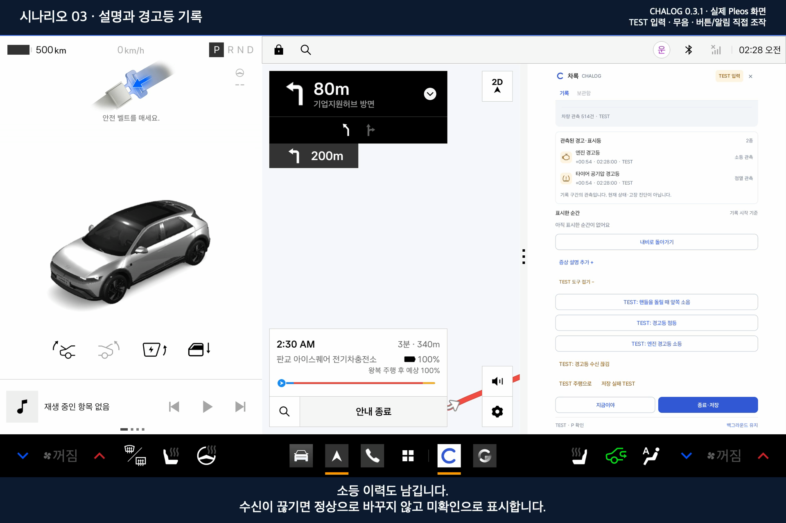

# 한글 자막 시연 · 실제 Mac Pleos TEST

**[완성 영상 MP4 · 2분 39초](chalog-verified-scenarios-ko.mp4)** · [UTF-8 자막 SRT](chalog-verified-scenarios-ko.srt) · [구간별 정확한 타임라인](chalog-verified-scenarios-ko.json) · [시나리오 설명과 검증](../../20-captioned-scenario-demo.md)

좌측 상단에 시나리오 제목, 하단에 해당 행동의 한국어 설명을 영상 픽셀로 넣었습니다. 시청 기기의 한글 폰트에 의존하지 않습니다. 앱/내비/차량 화면은 가리지 않고 전체 화면을 유지했습니다. SRT는 수정·보관용이며 영상에는 이미 자막이 들어 있습니다.

| 시작 | 시나리오 |
| --- | --- |
| 00:00 | 01 · 기록 준비 |
| 00:12 | 02 · 백그라운드 기록 시작 |
| 00:33 | 03 · 설명과 경고등 기록 |
| 01:14 | 04 · 순간 표시와 저장 |
| 01:49 | 05 · 다시 열어 상담 확인 |
| 02:13 | 06 · 재실행 후 기록 보존 |

**차록 입력은 TEST, 무음 영상입니다.** 시작/표시/종료는 직접 펼친 알림센터와 TEST 버튼으로 수행했습니다. 실제 Gleo 발화·차량 SDK·마이크·음악 재생 성공이 아닙니다. 우측 배치는 OS 수동 조작이며 자막에도 명시했습니다. 순정 내비는 에뮬레이터 기본 위치에서 공개 충전소를 직접 검색한 검증 경로입니다. 지도 바탕은 원래 비어 있는 상태를 그대로 담았습니다. 외부 보고서 전달·예약·고장 진단은 시연하지 않습니다.

## 완성 후 검증

- [최종 MP4 검사](video-verification.json): 1920×1280, H.264, 24fps, 159.167초, 무음. 전체 3,820프레임 디코딩 성공·타임스탬프 순증가·처음과 끝 프레임 정상. 17개 구간의 제목과 자막을 최종 영상에서 OCR로 읽어 모두 일치했습니다.
- [시각 검토](visual-review.json): 한글 글리프 누락/대체 문자 없음, 자막 영역 높이 검사, SRT 17구간 텍스트/시간 일치. 실제 [순간 표시 알림(89초)](frames/action-89.png)과 [저장 알림(100초)](frames/action-100.png), 상담·재실행 화면도 확인했습니다.
- [데이터 대조](demo-data-proof.json): 기존118개 모든 행 그대로, TEST 저장1개 추가 →119개·schema1·무결성ok. 실제 사전 구간59.831초, 설명1건/순간1건, 경고등2종 ON/OFF/BLINK/미수신, 화면 없는 관측643→812건. 저장 뒤987건 고정·새 PID 복원 후 동일 내용·자동 수집 없음.
- [APK 일치](installed-proof.json): 이전 기기15개/CI 검사를 통과한0.3.1/7의 동일 APK입니다. 앱 재설치·코드 변경 없이 촬영했습니다. [ADB 준비](readiness.json), [서비스/안내 종료와 AVD 정상 종료](shutdown-proof.json).
- [파일 SHA-256](artifact-hashes.json). 최종 영상 전체 디코딩과 한국어 OCR은 [검증 스크립트](../../../scripts/verify_captioned_demo.swift), 제작은 [렌더링 스크립트](../../../scripts/render_captioned_demo.swift)로 수행했습니다.

## 원본과 편집 범위

Android screenrecord에서 시스템 알림이 빠졌던 문제 때문에 [전체 디스플레이 연속 캡처](../../../scripts/capture_demo_frames.py)를 사용했습니다. [원본1,194장 해시 대조](capture-proof.json): 2560×1440, 약493초, 실효2.42fps(최대 캡처 간격1.32초). 출력24fps는 측정된 원본 시각에 맞춰 같은 프레임을 유지하는 방식이며 중간 움직임을 생성하지 않습니다. 원본 캡처 빈도에 따라 움직임은 제한됩니다.

시간 순서를 지키며 준비·검사 대기 구간만 잘랐고 재생 속도는 바꾸지 않았습니다. 실제 UI 위조·지도 보완·알림 합성·스틸 시안 삽입은 없습니다. 제목/자막 띠만 실제 화면 바깥에 추가했습니다. 원본 PNG·작업 로그·DB는 private-evidence에 보존하고 공개하지 않았습니다.

재실행 장면에서는 패널을 닫은 뒤 기존 프로세스가 이미 종료돼 있어 force-stop은 실행하지 않았습니다. 다음 명시적 OPEN은 COLD 실행이었고 PID24273→2091, 동일 기록/관측 불변·자동 수집 없음이 확인됐습니다. 이전 별도 강제 종료 복원 검사와 구분합니다. 영상 검사 보조 Swift 스크립트의 JIT 실행은 AppKit 링크 오류가 나 정식 컴파일 후 해결했으며 완성 영상의 실패가 아닙니다.
