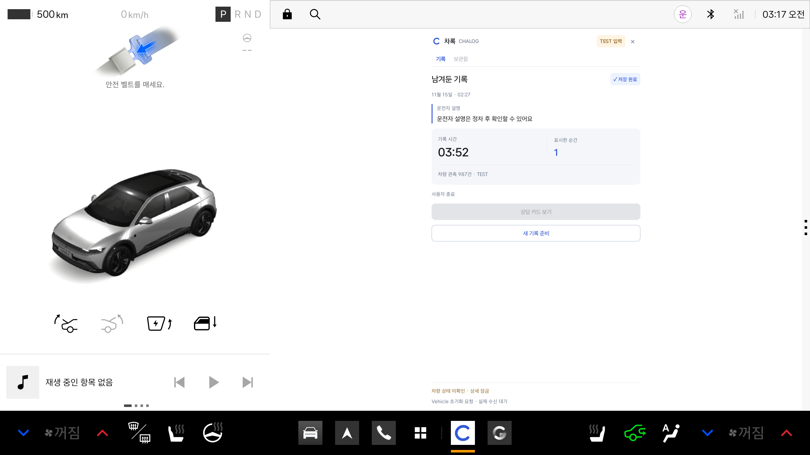

# CHALOG 0.3.2 · 이름 변경과 보존 업데이트 검증

소스 코드 **ce4990558b0afb943b3a6a9ccb1a2f0140175b0c**, **0.3.2 / versionCode8**. 실제 Mac M1 8GB·외장 SSD·기존 CharokPleosMac ARM64 API34/user10 한 대에서 검사했습니다. 로컬 빌드 중 AVD는 종료했으며 기존 no-audio 실행 환경을 유지했습니다.

| 확인 항목 | 결과·증거 |
| --- | --- |
| 저장소·원격·PR | leemh-dev/chalog, 동일 ID1458180705, 이전 URL 리다이렉트, PR #2 open·병합 없음. [이름 변경](repository-rename.json) |
| 소스·설치 ID | dev.leemh.chalog.ChalogApp/MainActivity, 기존 설치 ID dev.leemh.charok, 기존 런처 alias. [빌드 manifest](manifest-proof.json) |
| 빌드·단위·lint | debug/test/release 빌드 성공, JVM40개, lint 오류0·경고14. [요약](build-summary.json) |
| 설치 준비·서명 | ADB device/boot=1/package·activity 서비스 준비 후 install-r, 기존과 같은 Mac 개발 서명. [준비](install-readiness.json) · [서명 비교](upgrade-signature.json) |
| 설치 APK | [버전·SHA-256·서명](apk-metadata.json) · [설치 파일 해시 대조](installed-proof.json). unsigned release는 설치하지 않음 |
| 업데이트 직후 DB |119→119, 모든 기존 id/startedAt/payload 동일, schema1·Room identity hash 동일. [업데이트 직후 비교](upgrade-database-preservation.json) |
| 실제 Pleos 기기 검사 |16개 개별 instrumentation 성공. TEST 명시, 실제 Gleo 음성 검사가 아님. [전체 결과](device-tests.txt) |
| 새·구 OPEN/바로가기 |새 OPEN_CHALOG_RECORDS와 구 OPEN_CHAROK_RECORDS, 구 MainActivity alias 모두 작동. 호출한 functionName으로 성공 응답, 기록 건수·본문 동일, 수집/FGS 자동 시작 없음 |
| 백그라운드·알림·경고등 |기록/표시/종료/저장, 닫기 후 수집, 저장 실패·동일 ID 재시도, stale 알림 차단, 경고등 저장, 별도 TEST UID 보고서 접근·비권한 명령 차단 포함 |
| 새 PID 복원 |30550→32429, 같은 기록ID·INTERRUPTED·메모2·관측 불변. 실제 새 TEST seed를 확인하고 해당 앱만 force-stop. [기기 증거](process-recovery.json) · [검사 결과](process-restore.txt) |
| 검증 후 DB |119→133. 기존119개 전체 행 정확히 동일. 추가14개는 TEST 저장13·중단1, schema1·무결성ok. [전체 비교](database-preservation.json) |
| 종료 상태 |기록 FGS 없음, AVD 정상 종료. 원본 DB·작업 로그는 private-evidence에 보존 |

## 실제 업데이트 직후 화면

이전 시연 기록의 관측987건·순간1개가 유지됐습니다. 화면은 기본 실행 창이며 자동 우측 배치 성공을 뜻하지 않습니다. 차량 상태 미확인 시 상세 제한을 유지합니다.

## 범위와 이력

- 실제 Gleo 발화/등록, 차량 SDK·마이크·음악, 자동 우측 열기, 토스트 실제 노출, 차록에서 전송한 내비 목적지 성공으로 확대 해석하지 않습니다. 이번 변경은 이름·소스 namespace·설치 호환 검증입니다.
- 이전0.3.1 한글 자막 영상과 모든 과거 evidence/제출 초안은 수정하지 않았습니다. 영상은0.3.1 검증 이력으로 유지합니다.
- 부팅 초기에 ADB offline 및 Android 서비스 미준비가 확인되어 설치하지 않았고, 같은 AVD의 정상 준비를 기다린 뒤 설치했습니다. 인증 우회·키 복사·앱 삭제·데이터 초기화는 하지 않았습니다.

## GitHub CI와 산출물 대조

[CI43707910220](https://github.com/leemh-dev/chalog/actions/runs/43707910220), 코드ce49905: JVM40개·일반 Android 기기16개·별도 새 PID 복원 모두 성공했습니다. [검사·artifact 대조 요약](ci-summary.json) · [CI APK metadata](ci-apk-metadata.json) · [새 PID 검사 로그](ci-process-restore.txt).

[`chalog-apks-and-evidence` artifact14159438002](https://github.com/leemh-dev/chalog/actions/runs/43707910220/artifacts/14159438002)를 다운로드해 GitHub ZIP digest와 실제 SHA-256, APK3개 각각의 해시·패키지/버전·개발 인증서를 대조했습니다. ZIP SHA-256은 `cf6032b90f478f311da4a6f4bbc82f792282ea8f7a6b2782fd16a6466bcbc1c3`입니다. SDK별 apksigner의 `V2 Signer:`/`Signer #1` 출력 접두어 차이는 인증서 DN·SHA-256·SHA-1·MD5 값으로 정규화해 비교했습니다. 서명 검증 성공 여부도 일치합니다.

CI 인증서는 Mac의 기존 개발 인증서와 다르므로 CI APK를 Mac 앱 위에 설치하지 않았습니다. Mac에서는 기존 서명으로 빌드한 debug APK `56deee7ac78bc71ce5f72db3ab6f74d01933f96a2ed30d2e2ad1b4797fb5d56d`를 사용했습니다. release는 미서명으로 설치하지 않았습니다.
