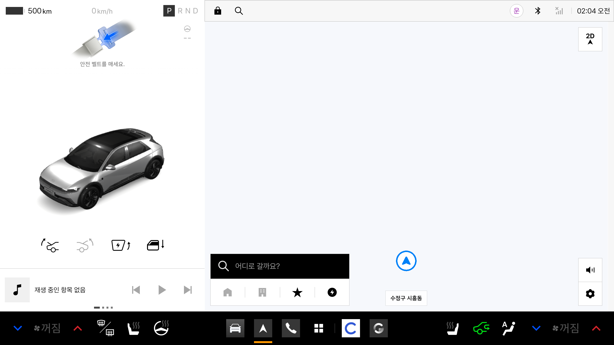
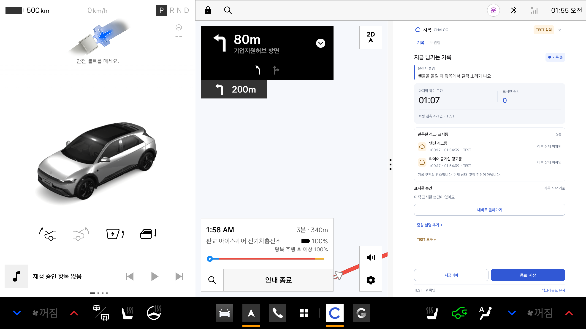
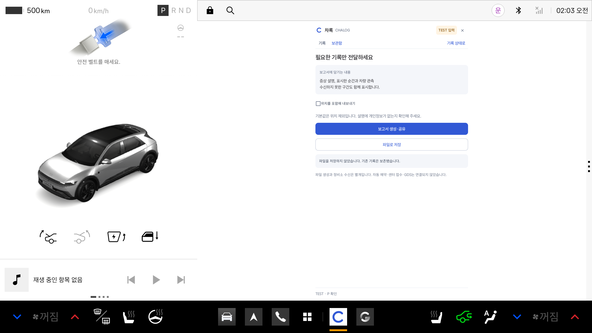

# Mac Pleos · 0.3.1 수정·재검증 증거

차록 · CHALOG **0.3.1/7**, 앱 코드 **8c8f793**. [전체 흐름·수정·번호순12개 판정](../../19-background-fixes-and-reverification.md).

이 화면은 실제 Mac Pleos입니다. **차록 입력은 TEST**이며 Broadcast 검사·순정 내비 직접 조작·OS 수동 창 배치를 실제 Gleo 발화/차량 SDK/자동 우측 지정으로 표시하지 않습니다. 내비 목적지는 에뮬레이터 기본 위치의 공개 충전소 검증 경로이며 개인 이동 기록이 아닙니다. [수정하지 않은 실제 캡처12장과 해시](screenshots.json).

- [Mac 빌드](build-proof.json): JVM39·lint0오류/14경고. [APK metadata](apk-metadata.json), [같은 개발 서명 업데이트](upgrade-signature.json), [설치된 앱/test APK 해시](installed-proof.json), [설치 직전 ADB/서비스 준비](install-readiness.json).
- [최신 CI](ci-summary.json), [실제 다운로드한 ZIP/APK/서명 대조·JVM39/Android15/PID 결과](ci-apk-crosscheck.json). CI와 Mac 인증서는 다르므로 기존 설치를 지우거나 CI APK로 덮어쓰지 않았습니다. unsigned release는 설치하지 않았습니다. 최초 CI43650320801 대조 이력은 이전 증거에 보존돼 있습니다.
- [Mac Pleos 기기15개 원본 결과](device-tests.txt): 기존9개와 Broadcast/권한/공유5개, 파일 저장 취소·미지원 안내1개. 모두 최종 APK에서 새로 실행했습니다. [새 PID 복원](process-restore.txt)과 [기기에서 직접 회수한 ID/PID/중단/관측 불변](process-recovery.json). seed의 강제 종료는 해당 TEST 프로세스만 대상으로 한 의도된 복원 검사입니다.
- [수동 흐름](manual-flow-proof.json): 사전 구간 59.815초, 화면 없는 관측 증가, 설명2/순간1, 같은 ID 저장 뒤 547건 고정. [보고서 대조](report-proof.json). 별도 TEST 수신 앱은 실제 정비소가 아닙니다. Pleos의 문서 저장 stub은 외부 파일을 만들지 않았습니다.
- [실제 연동 제한](integration-proof.json), [Console 브리지/DDS](console-readiness.json), [최종 서비스/화면 상태](runtime-proof.json), [정상 종료](shutdown-proof.json).
- [수정 전 실패와 해결](failures-and-fixes.json). portrait 여백, 테스트 헤더/별도 Kotlin 런타임/초기 상태 대기 오류, 숨겨진 보고서 결과를 각각 구분했습니다. 원본 로그와 이전 빌드 증거는 private-evidence에 보존했습니다.
- [DB 보존](database-proof.json): 최초77개 전체 행 동일, 최종118개, 추가41개 모두 TEST, schema1·무결성ok. 원본 DB·전체 로그·비밀값은 공개하지 않았습니다.

자동 OPEN 검사 직후 캡처는 패널이 그려지기 전의 프레임이어서 시각 증거에서 제외했습니다. 명시적 OPEN 표시 증거는 재실행 후 직접 확인한 [중단 복원 화면](screens/14-process-restored.png)과 runtime-proof의 postrestore 상태입니다.

새 시연 영상은 만들지 않았습니다. 이후 영상은 확인된 실제 동작에 한국어 기능 자막과 TEST/실제 연동 구분을 넣습니다. PR은 자동 병합하지 않습니다.
