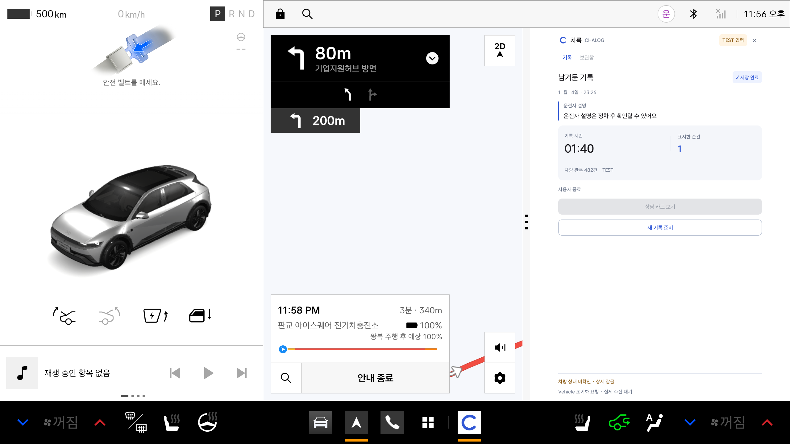
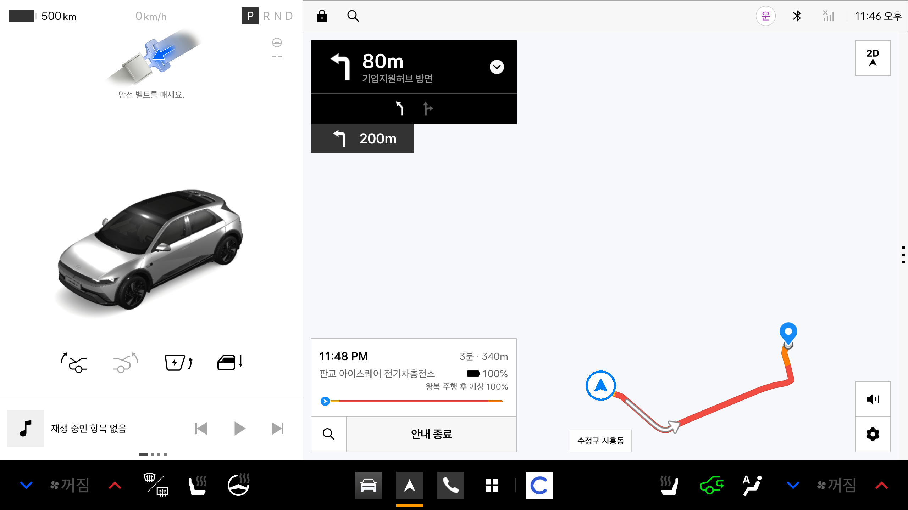

# Mac Pleos · CHALOG와 순정 내비

차록 **0.2.3/5**, 앱 코드 **1ed571d9d0ab4cc8aad7dcd7aa51530fb504ee42**. 영문은 CHALOG, 한글 서비스명·호출어는 차록입니다. 패키지/DB/기존 기록을 유지한 업데이트입니다. [브랜드와 내비 검증 범위](../../17-chalog-and-navigation.md).

## 실제 화면

차록의 기존 TEST 기록을 다시 열고, OS 창 조작으로 차량정보 왼쪽 / 순정 내비 중앙 / 차록 오른쪽에 표시했습니다. 자동 우측 배치나 Gleo 호출 성공이 아닙니다. 기존 2560×1440/density160을 유지했습니다.

에뮬레이터 기본 위치에서 공개 충전소를 선택한 검증 경로입니다. 순정 앱의 검색·목적지·경로 안내 시작은 성공했습니다. 340m·3분, 회전 안내와 목적지 핀·경로선이 보입니다. 도로·건물 바탕은 비어 있습니다. 실제 사용자의 이동 경로나 차록 NaviHelper 요청의 성공 증거가 아닙니다. 이번 경로는 ‘안내 종료’로 끝냈습니다. 정지 상태/no-audio여서 실제 주행·음성 안내는 미검증입니다.

[브랜드 업데이트 직후](screens/01-chalog-installed.png) · [원래 흰 지도](screens/02-native-map-before.png) · [충전소 검색](screens/03-native-search.png) · [SwiftShader 비교 실패](screens/07-swiftshader-settled.png) · [캡처 해시/출처](screenshots.json)

## 지도 바탕 문제

네트워크 probe와 초기화는 완료됐고 장소 검색·경로 계산이 실제로 동작했습니다. 초기 Unauthorized는 충전소 사업자 목록 API에서 관측했으며 지도 타일 인증 실패로 단정하지 않습니다. NMEA 체크섬과 OpenGL 0x501 오류도 함께 있어 원인을 분리했습니다.

같은 AVD를 정상 종료한 뒤 명령행 `-gpu swiftshader`로 한 번 비교했습니다. 배경 지도는 복구되지 않았고 이후 검은 지도와 ColorBuffer 오류가 나타나 기존 `-gpu host`로 돌아갔습니다. AVD 설정 파일은 바꾸지 않았습니다. 순정 APK 일반 ADB 읽기도 Permission denied여서 우회하지 않았습니다. host 복귀 직후 첫 앱 시작 명령은13.4초 timeout이었고, 이후 실제 앱 화면 표시/PID 유지/앱 fatal exception0건을 확인했습니다. **배경 지도 문제의 근본 원인은 아직 미확정/미해결**입니다. [관측·해석·한계](navigation-proof.json), [host 오류 집계](host-log-counts.json), [SwiftShader 오류 집계](swiftshader-log-counts.json). 민감한 인증 정보가 섞인 전체 logcat은 공개하지 않았습니다.

## 검증·데이터·APK

| 항목 | 결과 |
| --- | --- |
| Mac 빌드 | JVM31, lint 오류0/경고14, debug/test 성공. [요약](build-summary.json) |
| 일반 Android CI | [43690911090 전체 성공](https://github.com/leemh-dev/charok/actions/runs/43690911090): JVM31·기기9·새 PID 복원·lint·APK. [검사 보고서 요약](ci-summary.json) |
| Mac 수동 확인 | 0.2.3 설치·기존 저장 기록 재열기·CHALOG 헤더·OS 우측 배치. 내비 검색·안내는 순정 UI 직접 조작 |
| 기존 DB | 전후66개 전체 행(id/startedAt/payload) 정확히 동일, 무결성ok·스키마 유지. [보존 증거](database-proof.json) |
| 설치 | ADB/boot/package/activity 준비 후 같은 Mac 개발 서명으로 install -r. [준비](install-readiness.json), [서명](upgrade-signature.json), [설치 APK 해시](runtime-proof.json) |
| 종료 | 이번 작업에서 새 수집을 시작하지 않았고 검사 후 화면/서비스 상태 확인, AVD 정상 종료. [종료 증거](shutdown-proof.json) |

브랜드 변경이므로 Mac 기기9건 전체를 반복 실행하지 않았습니다. 0.2.2 Mac 기기 검사와 TEST 경고등 저장/복원은 [이전 증거](../macos-pleos-warnings-2026-11-15/README.md)에 보존했습니다. 이번 CI는 0.2.3 소스에 대해 일반 Android 전체 검사를 실행했습니다.

[Mac APK metadata](apk-metadata.json) · [CI APK metadata](ci-apk-metadata.json) · [artifact14151963753](https://github.com/leemh-dev/charok/actions/runs/43690911090/artifacts/14151963753) · [ZIP digest/APK3개 해시·버전·개발 서명 재대조](ci-apk-crosscheck.json). Mac과 CI 개발 인증서는 다릅니다. CI APK를 기존 Mac 앱 위에 설치하지 않았으며 unsigned release도 설치하지 않았습니다.

실제 차량/경고등 SDK 수신, 마이크, Gleo, 차록의 목적지 callback, 자동 우측 배치는 각각 별도 미검증입니다. 기존 안전 잠금·데이터·AVD를 유지했습니다. 새 영상과 자동 병합은 하지 않았습니다.
