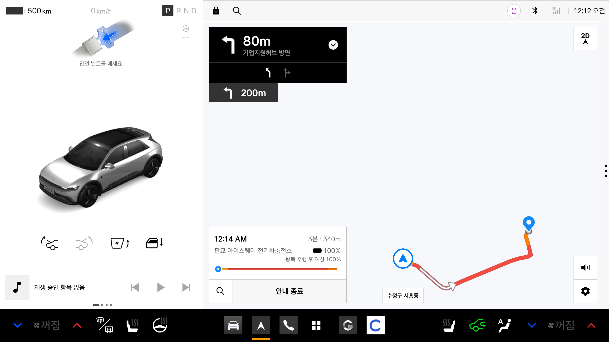
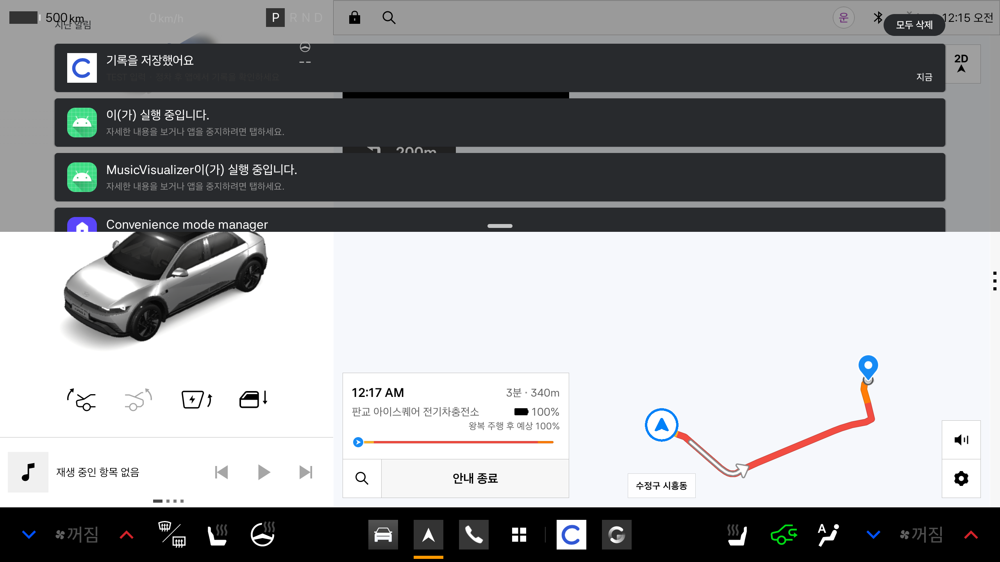
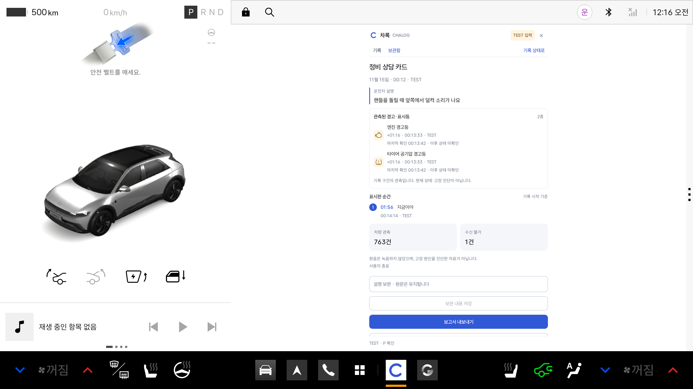

# Mac Pleos · 서비스 시나리오 검토

검토 대상 **차록 · CHALOG0.2.3/5, 앱 코드1ed571d**. 기존 설치의 앱/test APK SHA-256을 metadata와 대조했으며 새 빌드·설치는 하지 않았습니다. [전체 흐름도·번호순12개 시나리오·구현 차이와 판정](../../18-service-scenario-review.md).

**목표 제품 흐름 전체는 미완료입니다.** 이번 성공 범위는 명시적 TEST 준비·알림 기록/순간/종료·저장/상담/로컬 보고서·기기 예외 검사입니다. Gleo 실제 발화, 실제 차량/마이크 SDK, 자동 우측 배치, 음악 재생 유지와 외부 전달을 통과로 바꾸어 해석하지 않습니다.

## 실제 화면

[실제 입력의 안전 잠금](screens/02-consent-real-locked.png) · [TEST 준비](screens/04-test-preparing.png) · [알림에서 시작](screens/07-prepared-notification.png) · [경고등 이력](screens/09-warning-history.png) · [종료 후 내비 유지](screens/12-saved-notification.png) · [TEST 주행 상세 잠금](screens/14-saved-driving-lock.png) · [공유 앱 없음](screens/16-report-share-chooser.png) · [중단 복원](screens/17-process-restored.png).

[수정하지 않은 실제 캡처11장·해시/설명](screenshots.json). 에뮬레이터 시계·화면 밀도는 변경하지 않았고 새 영상을 만들지 않았습니다. 내비는 에뮬레이터 기본 위치의 공개 충전소340m 검증 경로이며 실제 사용자 이동 기록이 아닙니다. 이번 경로는 순정 UI에서 종료했습니다.

## 수동 흐름의 증거

- 준비 없는3 Action 직접 호출 뒤 기존66개와 FGS 없음 유지. 전용 OPEN Action은 resolve되지 않았습니다. [직접 Intent 검사](direct-intent-probe.json). **ADB 직접 호출이며 실제 Gleo 인식/응답 수신 검사가 아닙니다.**
- 명시적 TEST 동의/준비 후 알림으로 시작. 같은 ID에서 백그라운드 관측256→292건, 시작 전 실제59.23초. 원문 설명1+순간 표시1, ENGINE ON→OFF·TPMS BLINK·경고등 조회 실패를 기록했습니다.
- TEST 주행 상태에서도 알림 종료 성공. 같은 ID SAVED, 관측763→763건으로 정지, FGS 없음·MainActivity 없음·순정 안내 유지. [수동 흐름 검증값](manual-flow-proof.json).
- TEST 정차로 바꾼 후 상담 카드/보고서 확인. JSON은 저장된 DB 내용과 정확히 동일하며 TXT의763개 관측 행·설명2건·경고등 미확인 상태를 대조했습니다. 새 파일명은 chalog- 접두사입니다. [파일 증거](report-proof.json). 공유 가능한 앱이 없어 외부 수신자는 선택하지 않았습니다.
- 알림센터의 동작과 저장 문구는 확인했지만 짧은 heads-up 배너의 실제 노출/수명은 별도 미검증입니다.

## 실제 연동과 미충족 조건

[현재 Console 상태](console-readiness.json): bridge_ready=false·emulator_active=false·DDS=false. 앱 실제 운전 상태 미확인 잠금을 유지했고, TEST 기어/속도를 실제 SDK 입력으로 바꾸어 주장하지 않았습니다. 실제 경고등 getter 수신·차록 NaviHelper 요청은 미검증입니다. 순정 안내와 흰 배경 지도 문제는 별개입니다.

[음악 상태](media-proof.json)는 Bluetooth 오디오 연결 해제 ERROR이며 음악 재생 유지/실제 소리는 검사하지 못했습니다. 기존 CoreAudio 오류 이력에 따라 no-audio 실행을 유지했습니다. Gleo 앱의 리마인더 UI 열림은 확인했지만 실제 마이크 발화·schema 등록/Action 매핑 성공은 아닙니다.

코드상 Gleo 시작은 수동 준비가 필요하고3 Action 모두 Activity입니다. 명시적 OPEN/Broadcast 경로·자동 우측 열기가 없습니다. 처음 동의 후 화면 없이 기록한다는 최종 제품 시나리오와의 차이를 [검토 문서](../../18-service-scenario-review.md)에 우선순위로 남겼습니다.

## 기기 검사·복원·보존

- 실제 Mac Pleos에서 **9개 기기 메서드 각각 통과**. 메서드 사이5초 대기·DB 유지. 경고등 저장/재열기/보고서, 주행 상세 잠금/종료, 저장 실패 같은 ID 재시도, 화면 닫기/재열기, 알림 중복 시작, Activity 재생성/백그라운드/알림 종료, 빠른 중복 명령, 실제 Room 저장, 오래된 알림 재사용 거절. [원본 instrumentation 결과](device-tests.txt).
- 새 TEST seed의 ID/PID를 확인하고 호스트가 해당 프로세스만 force-stop한 뒤 새 PID로 복원했습니다. seed의 ‘Process crashed’는 의도한 강제 종료 결과이며 앱 크래시 결함으로 분류하지 않습니다. [복원 검사](process-restore.txt), [PID 변경 검사·같은 ID·INTERRUPTED·관측 불변](process-recovery.json). 자동 수집/마이크 재개 없음. user10 외부 저장소의 테스트 산출물은 접근 거절되어 우회하지 않았습니다. 공개 JSON은 통과한 검사와 앱 자체 DB의 전후 대조를 호스트에서 정리한 것이며, 복원 검사 프로세스의 정확한 PID는 미수집으로 표시합니다. 이후 직접 재열기 PID는 별도로 기록했습니다.
- 기존 **66개 모든 행이 정확히 동일**, 최종 **77개**, 새 기록은 명시적 TEST만 **11개**, 스키마1·무결성ok. [DB 보존 증거](database-proof.json). 기존 DB 원본·개인정보·전체 logcat은 공개하지 않았습니다.
- [실행 APK 해시·최종 FGS/화면 상태](runtime-proof.json), [기존 앱/test APK 대조](installed-proof.json), [준비 상태](readiness.json), [종료](shutdown-proof.json). 외장 SSD의 기존 Pleos AVD 한 대를 유지했습니다. 데이터 삭제·인증 우회·키 복사·자동 병합 없음.

이번에는 새 JVM/lint 빌드를 반복하지 않았습니다. 같은 앱 코드의 [CI43690911090](https://github.com/leemh-dev/charok/actions/runs/43690911090) JVM31·일반 Android 기기9·새 PID 복원 성공은 이전 증거입니다. 이번 Mac 검사를 해당 CI나 실차 검사로 표현하지 않습니다.
