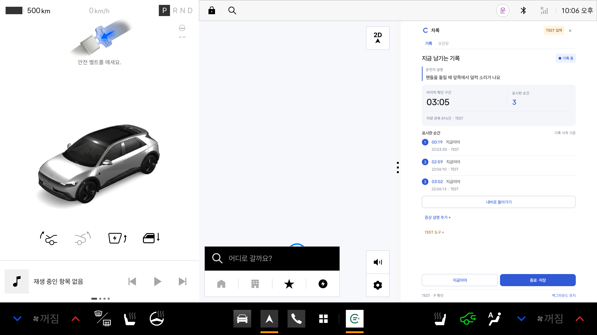
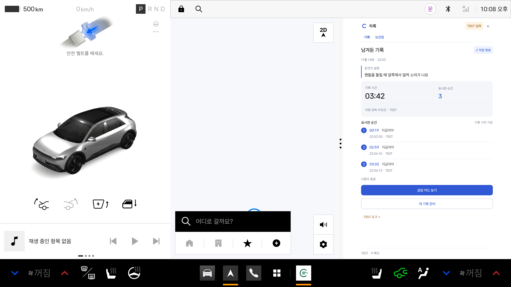
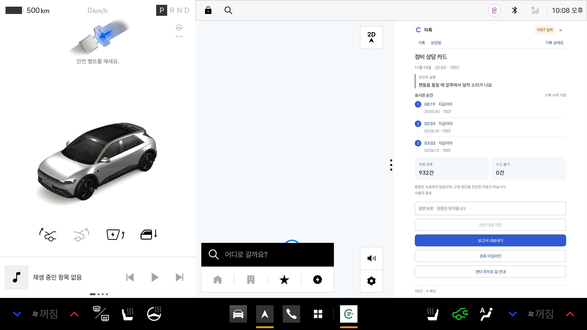

# SIGNAL · 실제 Mac Pleos 화면 검토

사용자가 선택한 A · SIGNAL을 **차록 0.2.1/3** 우측 앱 패널에 구현했습니다. 흰색 바탕과 코발트 강조색, 운전자 설명, 기록 시간과 순간 표시를 묶은 요약, 번호가 있는 타임라인을 적용했습니다. 차량정보·순정 내비는 기존 Pleos 화면입니다. 아래는 생성 시안이 아닌 실제 `screencap` 원본입니다.

**이번에는 영상 녹화·제작을 하지 않았습니다.** 다음 시연 영상의 한국어 장면 설명·TEST/실제 연동 자막 기준은 [시연 계획](../../09-demo-delivery-plan.md)에 반영했습니다.

## 실제 화면

입력은 **TEST**입니다. TEST 정차 상태에서 설명과 순간 표시를 확인했습니다. 오른쪽 위치는 실제 Pleos OS 창 조작으로 배치했으며, 앱의 자동 우측 열기나 Gleo 발화 성공을 뜻하지 않습니다. 순정 내비의 지도 바탕/기본 위치 표시는 목적지 경로 안내 성공과 구분합니다. 화면 시각은 기존 에뮬레이터 시계이며 호스트 날짜에 맞춰 변경하지 않았습니다.

| 화면 | 확인 사항 |
| --- | --- |
| [설치 직후](screens/01-first-installed.png) | 기존 TEST 기록 복원, 현재 실제 차량 상태 미확인으로 상세 잠금 |
| [준비](screens/02-prepared-right.png) | 동의 후 실제 준비 구간, 좁은 우측 패널 |
| [기록](screens/03-recording-right.png) | 운전자 설명, 수신 구간, 순간 표시 3개, 고정 하단 동작 |
| [화면 닫기](screens/04-background-nav.png) | 차록 화면 없이 순정 내비 유지, 서비스는 기록 중 |
| [시스템 알림](screens/05-notification.png) | 실제 Android 알림의 순간 표시·종료/저장 동작 |
| [알림에서 저장 후](screens/06-saved-nav.png) | 차록 대시보드 자동 표시 없음, 서비스 종료 |
| [저장 요약](screens/07-saved-right.png) | 명시적 앱 재진입 후 같은 저장 기록 |
| [상담 카드](screens/08-consultation-right.png) | 설명·순간·관측 932건, 상세 동작의 줄바꿈/배치 확인 |

모든 화면은 원본을 수정하지 않고 보존했습니다. [파일별 SHA-256](screenshots.json). 알림의 위치·크기는 OS가 정하며 커스텀 토스트를 구현한 것은 아닙니다. 기존 가상 SD 카드 경고는 포맷하거나 지우지 않았습니다.

## 글자와 버튼 크기

2560×1440, density160, 기본 글꼴 배율의 기존 Pleos AVD에서 확인했습니다. 화면 밀도나 시스템 글꼴 크기를 바꿔 캡처를 맞추지 않았습니다.

| 요소 | 적용 크기 |
| --- | --- |
| 화면 제목 | 26sp / 줄높이 34sp |
| 일반 본문·버튼 | 18sp |
| 운전자 설명 | 20sp / 줄높이 29sp |
| 보조 정보·출처 | 16sp |
| 기록 시간 | 38sp / 줄높이 46sp |
| 주요·보조 버튼 | 최소 높이 52dp, 모서리 12dp |
| 닫기 버튼 | 터치 영역 48dp |
| 콘텐츠 | 최대 폭 720dp, 창 너비에 따라 좌우 여백 24/30dp |

기존 제목 29sp·시간 46sp·주요 버튼 58dp를 줄였습니다. 본문과 터치 영역은 읽기·조작이 가능한 크기를 유지했습니다. [실측 환경과 크기](display-metrics.json). 준비·기록·저장·상담의 우측 창에서 잘림 없이 확인했습니다. 더 작은 모든 창과 확대 글꼴, 실차의 시선 거리까지 인증한 결과는 아닙니다.

요약은 최근 순간 3개와 설명 최대 5줄을 표시하고, 상담 카드에서는 전체 설명과 순간 기록을 보존합니다. 주행/상태 미확인 때는 설명·상세·내보내기 제한을 유지합니다. 기록 엔진·서비스·DB 스키마·Gleo 함수 구성은 변경하지 않았습니다. schema의 앱 버전만 0.2.1로 맞췄습니다.

## 설치·검사·데이터

- 앱 코드 **31ba254426eab16f2253dfd9a389c2ad27360c0d**, `feat/charok-recorder`. [Mac 설치 APK metadata](apk-metadata.json).
- 외장 SSD의 기존 SDK/AVD/Gradle을 사용하고, 빌드할 때 AVD를 종료했습니다. 기존 `CharokPleosMac` ARM64 API34/user10 한 대만 실행했습니다. 기존 오디오 문제에 따라 no-audio이며 마이크 검사가 아닙니다.
- 최초 cold boot 준비 검사에서는 boot 완료값과 package/activity 서비스가 아직 없었습니다. [초기 준비 결과](boot-readiness-initial.json)를 보존하고 정상 부팅을 기다렸습니다. 재부팅/초기화 없이 [설치 직전 모든 준비 검사](install-readiness.json)를 통과한 뒤 설치했습니다.
- 이전 설치본과 같은 Mac 개발 인증서를 대조하고 `install -r`로 갱신했습니다. [서명 대조](upgrade-signature.json). 설치 APK의 SHA-256도 metadata와 일치합니다. 키 복사·인증 우회·앱 데이터 삭제는 하지 않았습니다.
- Mac JVM **24건**, lint **오류 0 / 경고 14**, debug/test APK 빌드 성공. [빌드 결과](build-summary.json).
- Mac Pleos 기존 기능 **8개 메서드 모두 통과**. 각각 별도 instrumentation 프로세스, 실행 사이 5초 대기, DB 보존. [전체 개별 검사 로그](device-tests.txt). 이번 버전은 Mac 전체 묶음 실행/별도 프로세스 강제 종료 검사를 반복하지 않았습니다.
- [일반 Android CI43683208769](https://github.com/leemh-dev/charok/actions/runs/43683208769)는 JVM24·기기8·다른 PID 복원·lint·APK 빌드를 통과했습니다. [CI 요약](ci-summary.json).
- [CI artifact14149009486](https://github.com/leemh-dev/charok/actions/runs/43683208769/artifacts/14149009486)를 내려받아 ZIP digest, APK 3개의 해시·package/version·서명을 metadata와 대조했습니다. [CI 대조](ci-apk-crosscheck.json) · [CI metadata](ci-apk-metadata.json). CI 개발 서명은 Mac과 다르므로 기존 Mac 앱 위에 설치하지 않았습니다. unsigned release는 설치용 산출물이 아닙니다.
- 기존 **47개 기록의 payload 전체가 정확히 동일**합니다. 최종 DB **56개**, SQLite 무결성 **ok**. 수동 캡처 기록은 TEST/SAVED, 3분42초, 관측932건·설명1개·순간3개입니다. [DB 증거](database-proof.json). DB 원본은 공개하지 않았습니다.
- 화면 닫기 뒤 foreground service=true/MainActivity 없음, 알림 저장 뒤 service=false/MainActivity 없음, 상담 확인 후 다시 닫은 최종 상태도 모두 false입니다. [실행 상태 증거](runtime-proof.json). 저장과 화면 종료를 확인한 뒤 AVD를 정상 종료했습니다.

## 남은 실제 연동

이번 변경은 SIGNAL UI와 크기 조정입니다. 실제 SDK 관측·마이크 STT/TTS·Gleo 발화·UI 없는 Broadcast 진입·자동 우측 배치·센터 callback/순정 목적지 핀은 완료로 표시하지 않습니다. 이전 Console/VHAL·오디오 차단 이력은 [0.2 증거](../macos-pleos-v0.2-2026-11-15/README.md)에 보존했으며 이번 UI 작업에서 새 성공으로 갱신하지 않았습니다. 다음 실제 연동은 [Gleo 중심 방향](../../15-gleo-background-direction.md)의 개별 완료 기준을 따릅니다. 자동 병합은 하지 않았습니다.
