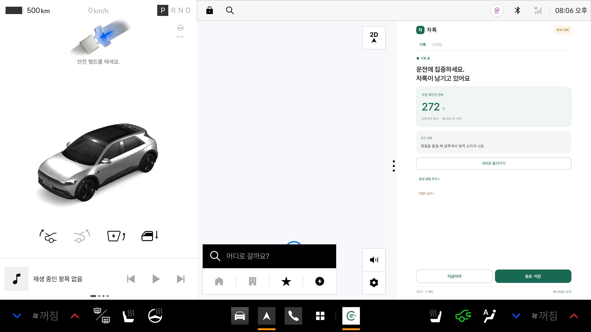
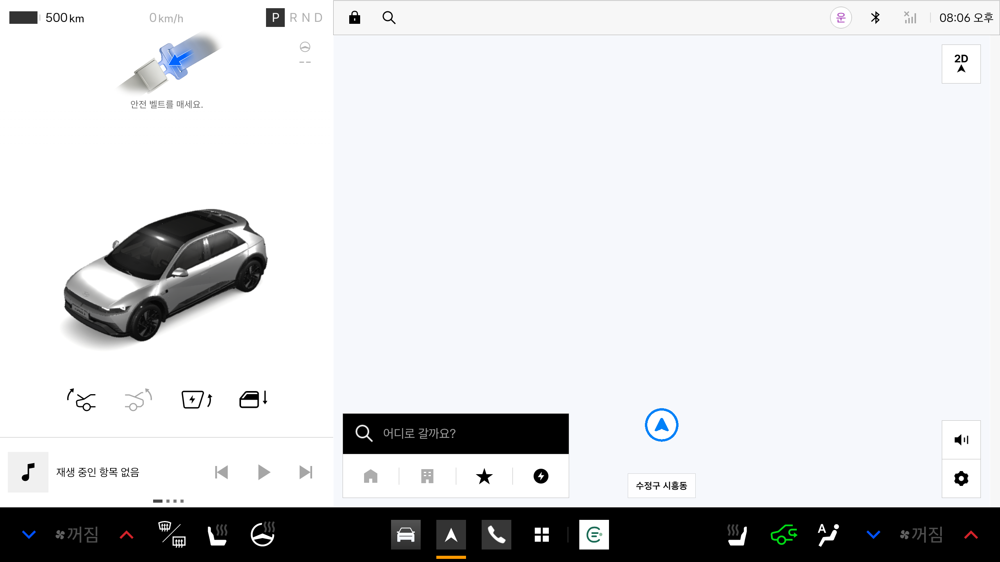
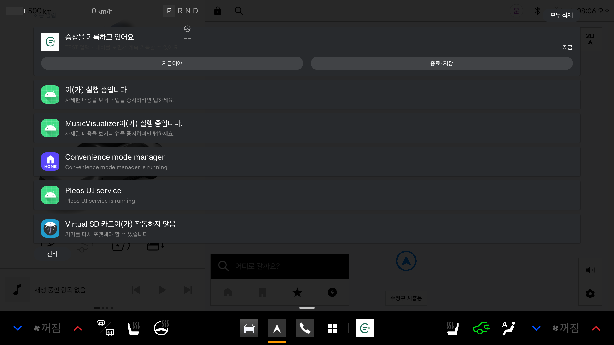
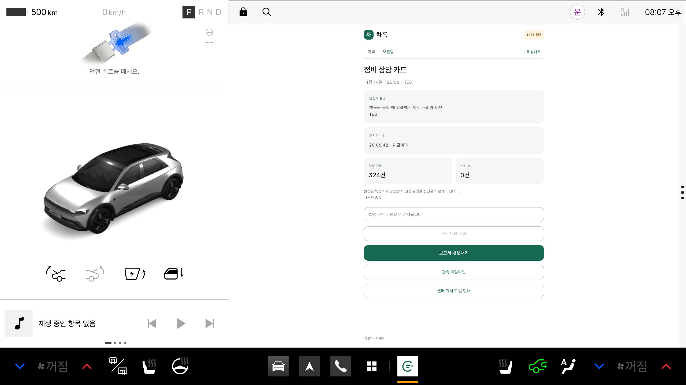
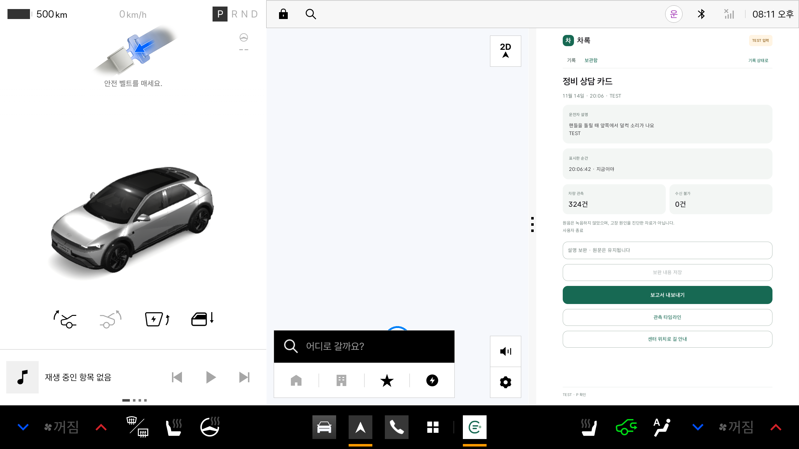

# Mac Pleos · 흰색 UI와 백그라운드 기록

차록 0.2.0/2는 사용자가 기록 준비를 켠 뒤 앱 화면을 닫아도 수집을 유지합니다. 진행 상태와 시작·순간 표시·저장은 Android 알림으로 확인하며, 앱을 직접 열면 같은 기록을 표시합니다. 알림 본문으로 재진입할 때 OS는 앱을 넓게 열었으며, 내비와 나란히 보려면 OS 창 손잡이로 분할을 다시 선택합니다. 흰색 화면을 적용하고 순정 내비를 가운데, 차록을 오른쪽에 배치했습니다.

검증 입력은 **TEST**입니다. 실제 차량 SDK·마이크·Gleo의 성공으로 해석하지 않습니다. [구현 원칙과 사용 동선](../../14-background-and-white-ui.md)을 참고하세요.

## 코드·설치

- 앱 코드: `091a4e2f3d1e4b3fe4f1e336ca600792a01ba419`. 문서 커밋은 별도입니다. [Mac APK metadata](apk-metadata.json)
- 이전 0.1 설치본부터 같은 Mac 개발 서명으로 `install -r` 업데이트했습니다. 삭제·초기화·인증 우회 없이 기존 기록 8개의 payload 전체가 그대로 유지됐습니다. 최종 DB는 47개이며 무결성은 ok입니다. [DB 증거](database-proof.json)
- 기존 외장 SSD SDK·CharokPleosMac ARM64 API34·user10·emulator-5560 한 대를 사용했습니다. 로컬 빌드 중에는 AVD를 정상 종료했습니다. no-audio 실행이며 마이크 검증 영상이 아닙니다.
- ADB device, boot=1, package/activity found 및 rc0을 확인한 뒤 설치했습니다. [설치 직전 준비](install-readiness.json) · [업데이트 서명 대조](upgrade-signature.json)
- [최종 CI 전체 성공](https://github.com/leemh-dev/charok/actions/runs/43674300468). CI APK는 CI 개발 서명이며, Mac 설치본의 개발 서명과 구분합니다. [CI artifact](https://github.com/leemh-dev/charok/actions/runs/43674300468/artifacts/14146181032)에 앱·test APK와 metadata가 있습니다. [artifact API 정보](ci-artifact.json)는 다운로드한 Mac APK 해시 대조와 구분합니다.

## 검증 결과

| 항목 | 확인한 결과 |
| --- | --- |
| Mac 빌드 | JVM 24건 통과, lint 오류 0·경고 14, debug/test APK 생성. [빌드 결과](mac-build-summary.json) |
| Pleos 기기 검사 | 8개 메서드를 각각 새 instrumentation 프로세스에서 실행해 통과. 화면 전환 안정화를 위해 후속 실행 사이 5초 대기를 적용했습니다. DB는 지우지 않았습니다. 기록/DB 재조회, 저장 실패 동일 ID 재시도, 주행 잠금, 백그라운드 준비→알림 시작, Activity 재생성→알림 순간/종료, 화면 종료→재진입 같은 ID, 중복 명령, 이전 알림의 새 기록 조작 차단. [검사 로그](device-tests.txt) |
| 프로세스 종료 | 별도 seed 기록을 force-stop 후 다른 PID에서 검증 1건 통과. 같은 ID·INTERRUPTED·관측 증가 없음. seed는 의도적으로 종료했으므로 완료 테스트에 세지 않습니다. [복원 검사](process-restore.txt) |
| 수동 흐름 | 준비 동의와 정상 알림 권한 승인, TEST 준비·설명·기록, 화면 닫기, 순정 내비 유지, 알림 순간 표시·저장, 앱 재진입·상담 카드 확인 |
| 화면 배치 | 실제 OS 손잡이로 차량 / 순정 내비 / 차록 순서 확인. 앱은 차록 패널만 그립니다. 지도 바탕·기본 위치 표시와 목적지 경로 안내 성공은 구분합니다 |
| 실제 입력 | Console/VHAL 비활성은 여전히 차단입니다. 앱은 실제 상태 미확인 잠금을 유지합니다. 실제 SDK 관측·마이크 STT·TTS·Gleo 발화/세 Action·센터 callback/목적지 핀은 미검증 |

초기 `moveTaskToBack()`은 Pleos의 앱 창을 숨기지 못했습니다. `finish()`로 화면만 닫도록 바꾸고 서비스·같은 ID 유지 검사를 추가했습니다. 기기 검사 중에는 기록 화면 전환을 기다리지 않고 TEST 주행 버튼으로 진행한 타이밍 실패가 발생했습니다. [실패 원본](device-tests-timing-failure.txt)을 보존하고, 기록 화면 대기와 검사별 서비스 정리를 추가한 뒤 통과했습니다. 기록을 삭제하거나 실패를 새 세션으로 덮지 않았습니다. 알림 병합 수정 전 `7e52050`의 Pleos 묶음 실행에서는 Compose 화면 참조와 ActivityScenario 종료 단계의 오류가 2건 발생했습니다. [묶음 실행 원본](device-tests-suite-lifecycle-failure.txt)을 보존하고 각 메서드를 별도 instrumentation 프로세스에서 다시 실행해 확인했습니다. 최종 `091a4e2` 개별 검사에서도 화면 준비 중 Compose 루트를 찾지 못한 [실패 원본](isolated-background-platform-failure.txt)이 남았습니다. 나머지 메서드는 실행 사이에 5초 대기를 두고 재실행해 통과했습니다. `device-tests.txt`는 같은 최종 APK의 성공한 8개 개별 실행을 모은 로그이며, 최종 APK의 Pleos 전체 일괄 실행 통과를 의미하지 않습니다. 일반 Android CI 전체 일괄 실행 결과와 구분합니다.

Android가 초당 연속 알림 일부를 버리는 `Package enqueue rate ... Shedding`도 확인했습니다. [제한 로그](notification-rate-failure.txt)를 보존하고, 상태를 1초 간격으로 병합해 최신 상태를 전달하도록 수정했습니다. 묶음 실행 당시의 화면 오류는 [Pleos 홈 앱의 중복 task listener 크래시](pleos-homescreen-crash.txt)와 함께 발생했습니다.

알림 액션은 서비스 인스턴스별 URI와 토큰을 사용합니다. 이전 PendingIntent를 새 준비 중에 실행해도 새 기록을 시작하지 않는 것을 검사했습니다. 알림 본문에는 증상 원문과 위치가 들어가지 않으며, 전체 앱 화면을 자동으로 열지 않습니다. 팝업 표시 방식은 OS 설정에 따릅니다.

## 실제 화면과 영상

[실제 Pleos 시연 영상](charok-white-background-demo.mp4)은 89.8초의 TEST 입력·무음 영상입니다. 준비→기록·설명→앱 화면 닫기→알림 조작→상담 확인의 실제 실행을 녹화했습니다. 단, 시스템 알림 패널은 표준 Android screenrecord 영상에 나타나지 않았습니다. 영상에서 확인 가능한 것은 앱 준비·기록 화면, 화면 종료 뒤 순정 내비, 저장 후 상담 카드입니다. 알림 버튼과 실제 조작 결과는 위 screencap 화면, 기기 검사, 실행 상태 및 DB 증거로 따로 확인합니다. 시연 기록은 관측 324건, 순간 표시 1개이며 DB에 SAVED로 남았습니다. [영상 검사](video-check.txt) · [영상 해시·트랙 정보](video-metadata.json) · [실행 증거](runtime-proof.json)

## 남은 실제 연동 검증

[Console 상태](console-readiness.json)와 [기존 환경 차단 분석](../macos-pleos-2026-11-15/README.md)을 따릅니다. 정상 권한만 사용하며 VHAL/SecureStorage 오류를 보안 설정 변경으로 우회하지 않습니다. Gleo는 투명한 Activity 진입점으로 분리했지만 실제 음성 호출은 별도 검증이 필요합니다. 앱 자체 STT는 화면을 떠나면 닫으며 백그라운드 원음 녹음을 추가하지 않았습니다. 기존 DB·AVD를 보존했고 자동 병합하지 않았습니다.
