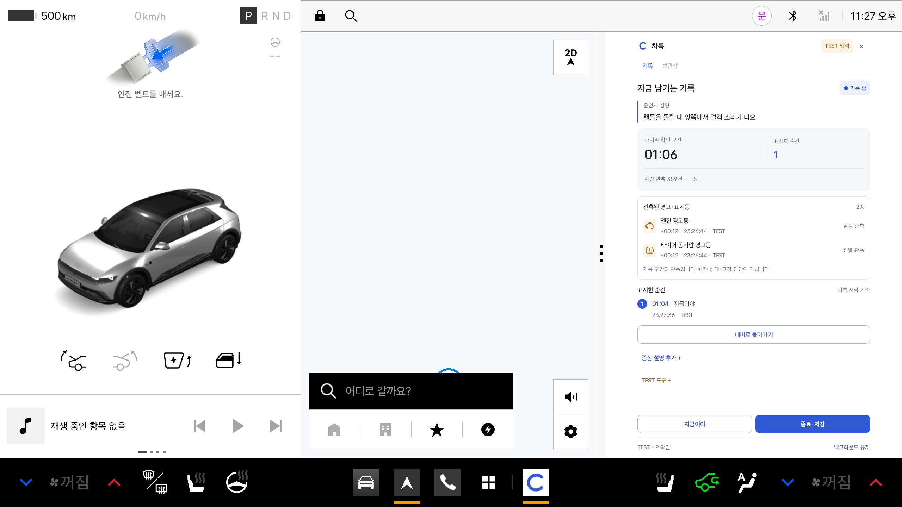
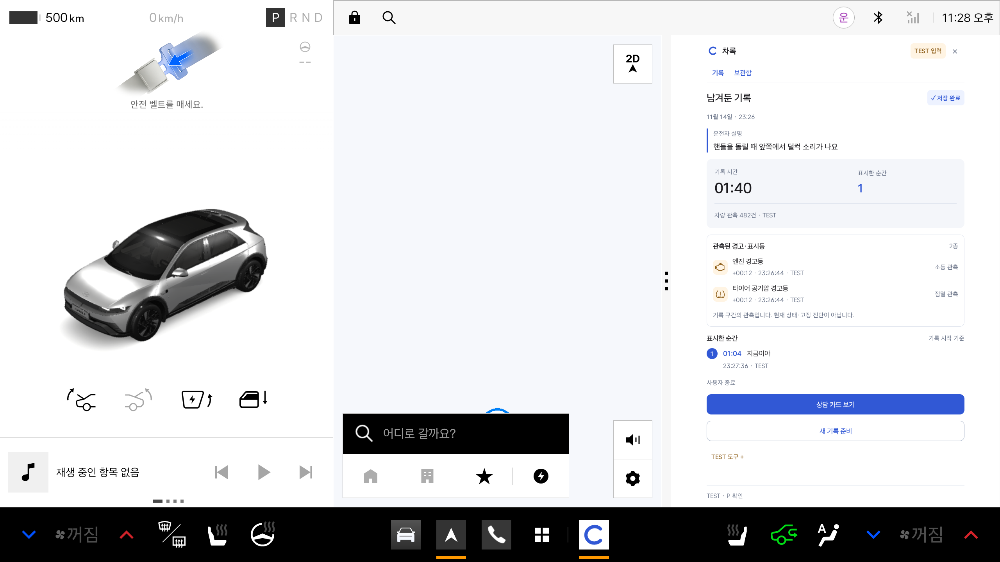
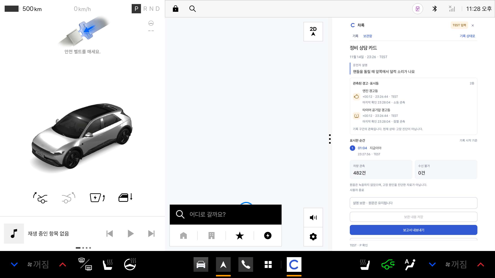

# Mac Pleos · 관측된 경고·표시등

차록 **0.2.2/4**, 앱 코드 **79d93a18a51bb7d1649cd5ee2e5ce921fbcefec8**. SIGNAL 기록 요약·상담 카드·선택 보고서에 경고등 이름, 최초 관측 시각, 출처, 마지막 확인 상태를 추가했습니다. 점등 뒤 소등된 이력도 보존합니다. [표시/SDK/누락 처리 명세](../../16-warning-light-observations.md).

## 실제 화면 · TEST

엔진 ON·타이어 공기압 BLINK를 **앱의 명시적 TEST 버튼**으로 입력하고, 엔진 OFF를 입력한 뒤 저장했습니다. 실제 SDK 경고 수신 화면이 아닙니다. 순정 차량정보/내비와 차록의 우측 배치는 실제 Pleos OS 창 조작입니다. 시스템 영역은 차록이 그리지 않았으며 목적지 경로 안내·자동 우측 열기의 성공을 뜻하지 않습니다.

같은 흰색/코발트 SIGNAL 크기를 유지하고 경고등 카드를 추가했습니다. 엔진·타이어 아이콘과 관측 상태가 우측 창에 들어가는 것을 확인했습니다. 상담 카드 하단 동작은 세로 스크롤로 접근합니다. [차록을 닫은 뒤 순정 내비](screens/04-closed-nav.png) · [수정하지 않은 캡처4장과 SHA-256](screenshots.json). 기존 에뮬레이터 시계/밀도를 변경하지 않았습니다. 영상은 녹화·제작하지 않았습니다.

## 검증과 보존

| 항목 | 결과 |
| --- | --- |
| Mac 빌드 | JVM31건(새 경고등7건 포함), lint 오류0/경고14, debug/test APK 성공. [결과](build-summary.json) |
| Mac Pleos | 기기9개 메서드 각각 별도 instrumentation 실행, 모두 통과. 실행 사이5초 대기·DB 보존. 새 검사: 점등→소등→같은 ID 저장→Activity 재생성→상담/보고서. [로그](device-tests.txt) |
| 일반 Android CI | [CI43689445105](https://github.com/leemh-dev/charok/actions/runs/43689445105) JVM31·기기9·새 PID 복원·lint·APK 빌드 모두 성공. [요약](ci-summary.json). Mac의 전체 묶음/별도 강제 종료 검사는 이번에 반복하지 않음 |
| 수동 TEST | 설명1·순간1, ENGINE ON→OFF, TPMS BLINK→BLINK, 1분40초·관측482건·SAVED. 화면/DB 동일 기록 확인 |
| 기존 DB | 업데이트 전56개 payload 전체가 정확히 동일. 최종66개·SQLite 무결성ok. [증거](database-proof.json). DB 원본은 비공개 |
| 설치 | cold boot 초기 준비 미완료를 기다린 뒤 device/boot1/package/activity 모두 준비됨을 확인. 같은 개발 서명으로 install -r. [준비](install-readiness.json) · [초기 상태](boot-readiness-initial.json) · [서명 대조](upgrade-signature.json) |
| 실행 종료 | 저장 후 화면 닫기, service=false/MainActivity 없음, 설치 APK 해시 일치. [실행 상태](runtime-proof.json). [AVD 정상 종료](shutdown-proof.json) |

외장 SSD의 기존 SDK/AVD/Gradle과 Pleos 한 대만 사용했고, 로컬 빌드 중에는 AVD를 종료했습니다. 기존 오디오 차단 이력에 따라 no-audio로 실행했습니다. 데이터 삭제·AVD 초기화·인증 우회·키 복사·자동 병합은 하지 않았습니다.

## 실제 SDK와 APK 구분

Vehicle2.3.2의 공개 `Safety.getTelltalesInfo`를 준비/기록 중 최대5초 간격으로 조회하도록 연결했습니다. `CAR_SAFETY`가 필요하며 정상 권한이 없거나 조회에 실패하면 미수신으로 남깁니다. 이번 설치에서 해당 권한은 granted=true이며 PRIVATE_CAR_SAFETY는 선언하지 않았습니다. [정적 API/권한 대조](sdk-review.json) · [실제 설치 권한](safety-permission.json).

**권한 부여와 컴파일 성공은 실제 경고 수신 성공이 아닙니다.** 실제 차량 상태 미확인/기존 VHAL 환경 차단 때문에 이 화면은 TEST로 검증했습니다. 실제 getter 수신·실차·마이크·Gleo·순정 목적지 안내는 별도 미검증입니다. 누락을 소등/정상으로 바꾸거나 경고등을 고장 원인으로 진단하지 않습니다.

[Mac 설치 APK metadata](apk-metadata.json)와 [CI APK metadata](ci-apk-metadata.json)는 같은 소스 버전이지만 서로 다른 개발 인증서를 사용합니다. [CI artifact14151208545](https://github.com/leemh-dev/charok/actions/runs/43689445105/artifacts/14151208545)를 다운로드해 ZIP digest·APK3개 해시·package/version·서명을 재대조했습니다. [대조 결과](ci-apk-crosscheck.json). CI APK를 기존 Mac 앱 위에 설치하지 않았고 unsigned release도 설치하지 않았습니다.
